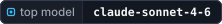
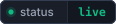
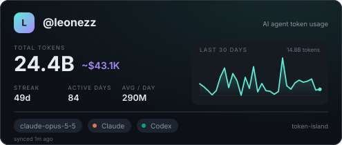

# Token Island

本地优先的 AI Coding Agent Token 用量追踪工具：macOS 灵动岛实时显示今日消耗，可选云端服务生成个人数据看板与 GitHub README 徽章、名片和图表。

[](https://github.com/Leonezz/token-island/actions/workflows/ci.yml)


<p align="left">
  
  
  
  
  
  
  
</p>

<table>
  <tr>
    <td width="50%"></td>
    <td width="50%"></td>
  </tr>
  <tr>
    <td></td>
    <td></td>
  </tr>
</table>

---

## 核心功能

- **多 Agent 统一统计**：自动增量解析本地 **Claude Code**（`~/.claude`）、**OpenAI Codex**（`~/.codex`）、**OpenCode**（`~/.local/share/opencode`）与 **DeepSeek Harness**（`~/.dsh`）日志，汇总输入、缓存读/写、输出、推理 Token 及按公开价目表估算的花费。
- **隐私与本地优先**：原始会话日志、项目路径与 Prompt 内容**永远留在本地**（SQLite `~/.token-island/data.db`，仅监听 `127.0.0.1:47118`）；不开启云同步时零外发请求。
- **macOS 原生灵动岛小组件**：悬浮于屏幕顶部/刘海区域（无 Dock 图标、不抢焦点），收起态展示今日用量与估算花费，悬停/点击展开查看输入/缓存/输出比例、14 天柱状趋势、Top 模型与活跃会话。
- **可选云端看板与 README 组件**：云端仅接收每日聚合数字，支持 **Cloudflare Workers + D1** 或 **Node + SQLite** 部署，提供深浅双色公开看板（`/u/:user`）及可直接嵌入 GitHub README 的矢量 SVG（`badge.svg` / `card.svg` / `chart.svg`）。

---

## 安装与本机使用

**环境要求**：Node.js `>= 22.5`、pnpm `10+`；原生灵动岛 App 需 `macOS 13+`（已安装 Xcode Command Line Tools）。

### 1. 克隆与安装依赖

```bash
git clone https://github.com/Leonezz/token-island.git
cd token-island
pnpm install
```

### 2. 一键安装本机服务与灵动岛（推荐）

自动编译 macOS 灵动岛 `.app`（安装至 `~/Applications`），并注册 Collector 与灵动岛两个用户级开机自启项（无需 `sudo`）：

```bash
node bin/tokenisland.mjs install
```

> 若首次打开提示「无法验证开发者」（App 为本地 ad-hoc 签名），在 `~/Applications` 中右键 `TokenIsland.app` → **打开** 即可。卸载自启项执行 `node bin/tokenisland.mjs uninstall`（保留 `~/.token-island` 历史数据）。

### 3. 手动运行 / 打包 DMG（按需）

```bash
# 在前台单独运行本地采集器（首次自动回填最近 30 天记录）
node bin/tokenisland.mjs collect --foreground

# 查看采集器运行状态
node bin/tokenisland.mjs status

# 单独编译 macOS 灵动岛 App 或打包 DMG
pnpm island:build
bash apps/island-macos/scripts/package-dmg.sh

# 使用内置演示数据预览灵动岛
apps/island-macos/build/TokenIsland.app/Contents/MacOS/TokenIsland --demo
```

---

## 云端部署与 GitHub README 嵌入（可选）

### 1. 启动或部署云端服务

- **Cloudflare Workers + D1（生产推荐）**：详见 [apps/cloud/DEPLOY-CLOUDFLARE.md](apps/cloud/DEPLOY-CLOUDFLARE.md)
  ```bash
  wrangler d1 create token-island-cloud        # 将 database_id 填入 apps/cloud/wrangler.toml
  wrangler d1 migrations apply token-island-cloud --remote
  pnpm --filter @token-island/cloud worker:deploy
  ```
- **Node + SQLite（本地或 Docker 自托管）**：详见 [apps/cloud/DEPLOY.md](apps/cloud/DEPLOY.md)
  ```bash
  node bin/tokenisland.mjs cloud start         # 默认监听 http://127.0.0.1:47117
  ```

### 2. 注册账号并同步每日聚合数据

```bash
# 注册用户名并将 API Key 写入 ~/.token-island/config.json（权限 600）
node bin/tokenisland.mjs register --cloud <云端地址> --username <你的用户名>

# 立即同步（Collector 运行时默认每 15 分钟自动同步）
node bin/tokenisland.mjs sync
```

同步后访问 `<云端地址>/u/<你的用户名>` 即可打开个人看板并复制嵌入代码。

### 3. 嵌入 GitHub README

**方式 A：公网服务实时 URL**（支持 `theme=auto|dark|light`）

```markdown
[](https://your-domain.example/u/your-name)
[](https://your-domain.example/u/your-name)
[](https://your-domain.example/u/your-name)
```

**方式 B：导出静态 SVG 提交到仓库**（无需公网服务器）

```bash
node bin/tokenisland.mjs export --cloud http://127.0.0.1:47117 --user <你的用户名> --out docs/badges --days 30
```

| 路由 | 主要查询参数 |
| :--- | :--- |
| `/u/:user/badge.svg` | `metric=tokens\|cost\|streak\|messages\|day\|model\|status`、`days=1..365`、`label=<自定义>`、`style=flat\|flat-square`、`theme=auto\|dark\|light` |
| `/u/:user/chart.svg` | `type=line\|bar\|heatmap\|models`、`days=7..365`、`width`、`height`、`theme=auto\|dark\|light` |
| `/u/:user/card.svg` | `width=420..800`（默认 `520`）、`theme=auto\|dark\|light` |
| `/u/:user` | `?theme=dark\|light\|auto`（公开数据看板） |

---

## 配置与常用命令

配置文件位于 `~/.token-island/config.json`（所有字段均可省略）：

```json
{
  "port": 47118,
  "timezone": "auto",
  "backfillDays": 30,
  "scanIntervalMs": 2000,
  "sources": { "claude": true, "codex": true, "opencode": true, "dsh": true },
  "prices": [
    { "match": "my-custom-model", "input": 0.5, "output": 1.5 }
  ],
  "cloud": {
    "enabled": true,
    "url": "https://your-domain.example",
    "username": "your-name",
    "apiKey": "ti_...",
    "autoSync": true,
    "intervalMinutes": 15
  }
}
```

常用 CLI 命令（`node bin/tokenisland.mjs <command>`）：

| 命令 | 说明 |
| :--- | :--- |
| `install` / `uninstall` | 安装 / 卸载 macOS 灵动岛 App 与 Collector 开机自启项 |
| `collect [--foreground] [--once] [--demo]` | 启动本地日志增量采集服务 |
| `status` / `doctor` | 查看本地服务状态 / 环境与资源体检 |
| `register` / `sync` | 注册云端账号 / 手动推送每日聚合数据 |
| `export` | 导出全套静态 SVG 徽章、名片与图表 |
| `cloud start` / `cloud dev` / `cloud deploy` | 运行 Node 云端 / 本地 Worker 调试 / 部署 Cloudflare Worker |

---

## License

[MIT](LICENSE)
