# Token Island

> **本地优先的 AI Coding Agent Token 追踪器**：macOS 灵动岛实时显示今天花了多少 token，云端一键生成 GitHub README 徽章、图表和名片。


<p align="center">
  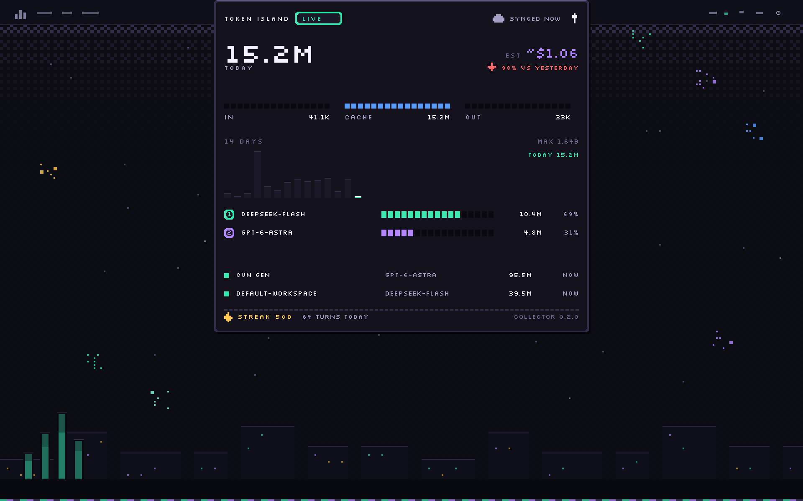
</p>

<p align="center">
  
  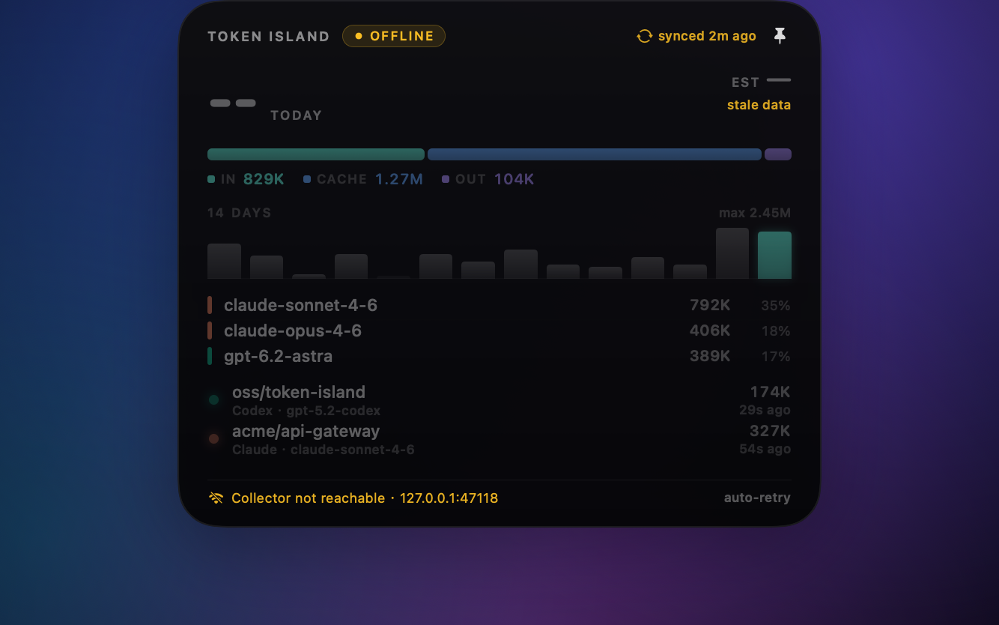
</p>

---

## 为什么做这个

同时使用 Claude Code、OpenAI Codex、OpenCode、DeepSeek Harness 时，**token 消耗分散在各个 agent 的会话日志里，无从感知**：

- 每个 agent 各写各的日志，没有一个地方能回答「我今天到底用了多少 token」；
- 供应商后台只按账号/账单汇总，看不到是哪个项目、哪个模型、哪个时段在消耗；
- 等月底看到账单才后知后觉，已经很难回头调整用法；
- 想放进 GitHub 主页或 README，却没有现成、好看、可自动更新的组件。

Token Island 把这件事拆成三层，**全部可以只在本地运行**：

1. **Collector**：增量解析本机 agent 会话日志，归一化后写入 SQLite，暴露本地 HTTP API；
2. **Dynamic Island（灵动岛）**：macOS 原生 SwiftUI 小组件，悬浮在刘海/屏幕顶部，每 2 秒刷新；
3. **Cloud**：零依赖 Node 服务，只接收**每日聚合**数据，渲染 GitHub README 友好的 SVG 徽章、图表、名片和仪表盘。

## 核心特性

- **多 agent 统一口径**：Claude Code / OpenAI Codex / OpenCode / DeepSeek Harness 统一为 `UsageEvent`（输入、输出、缓存读、缓存写、推理 token 与估算成本）；单 source 出错不影响整体。
- **本地优先**：原始日志从不离开本机；collector 只监听 `127.0.0.1`。
- **增量 & 幂等**：按文件 offset 增量读取、事件 id 去重，重启/重复扫描不会重复计数，大文件流式解析。
- **实时灵动岛**：收起态显示今日 token；展开态有成本、输入/缓存/输出占比、14 天曲线、Top 模型、活跃会话、streak 和离线态。
- **GitHub README 组件**：7 种 `badge.svg` 指标、4 种 `chart.svg`（line / bar / heatmap / models）、`card.svg` 名片、带可复制嵌入代码的 dashboard。
- **零运行时依赖**：除 Node.js 内置模块与 macOS 原生 SwiftUI 外，不引入第三方运行时包。
- **可离线演示**：`collect --demo` 提供确定性演示数据；灵动岛可用 `--demo` 加载内置 fixture 独立展示。
- **一条命令验证**：`pnpm e2e` 覆盖 core 测试 → collector demo API → cloud seed/SVG/dashboard → 灵动岛快照。

## 云端输出一览

<p align="center">
  <picture>
    <source media="(prefers-color-scheme: dark)" srcset="docs/images/badges-dark.png">
    <source media="(prefers-color-scheme: light)" srcset="docs/images/badges-light.png">
    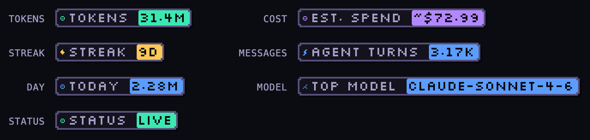
  </picture>
</p>

<p align="center">
  <picture>
    <source media="(prefers-color-scheme: dark)" srcset="docs/images/dashboard-dark.png">
    <source media="(prefers-color-scheme: light)" srcset="docs/images/dashboard-light.png">
    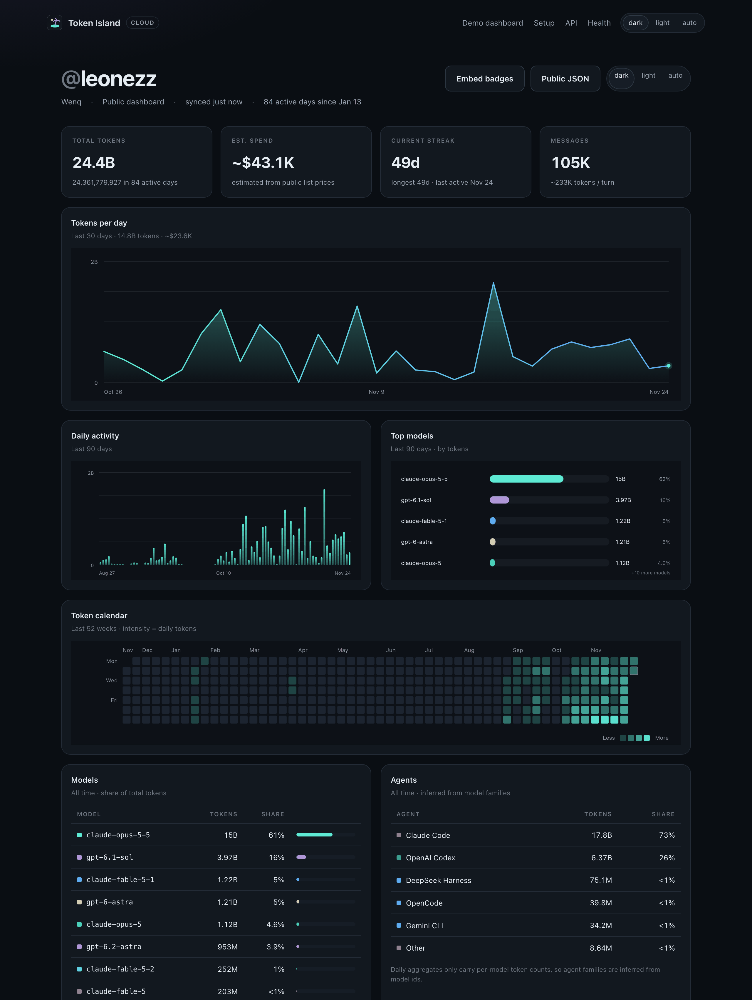
  </picture>
</p>

<table>
<tr>
<td width="50%">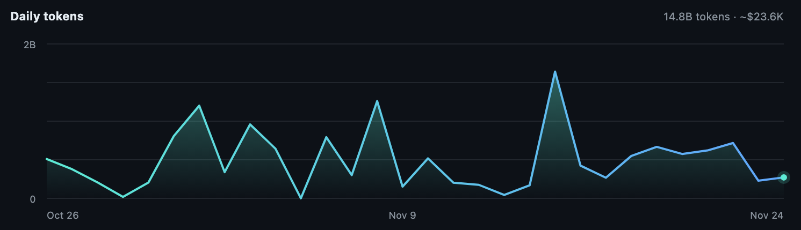</td>
<td width="50%">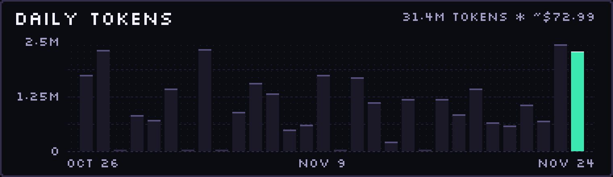</td>
</tr>
<tr>
<td>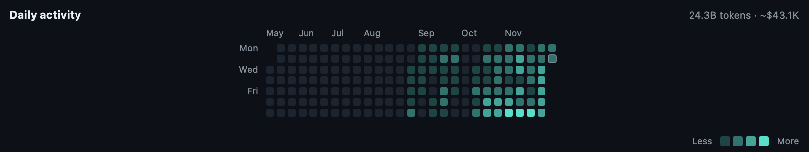</td>
<td>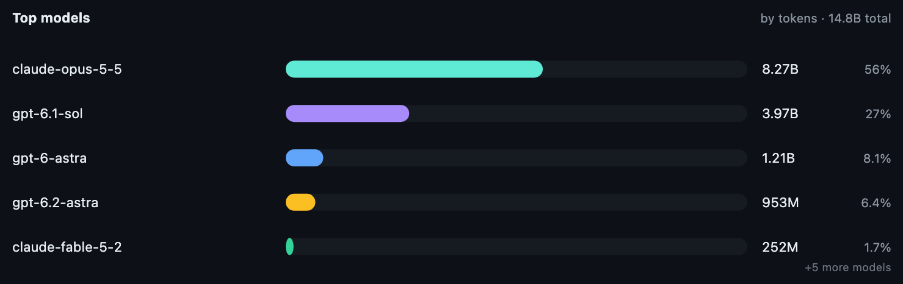</td>
</tr>
</table>

<p align="center">
  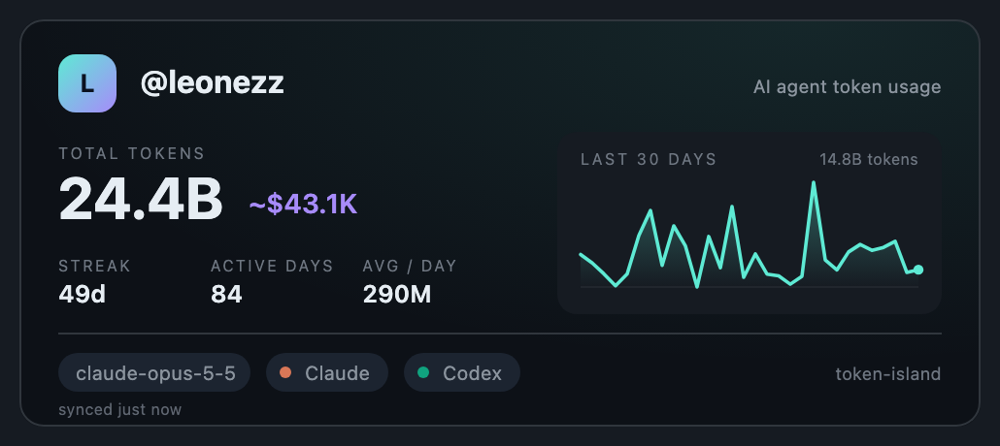
  
</p>

<details>
<summary>移动端视图（390px）</summary>

<p align="center">
  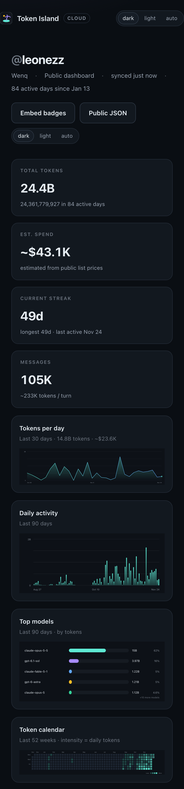
</p>

</details>

> 截图与徽章数据来自本机真实同步的示例账号（用户名 `leonezz`），通过本地 demo cloud 渲染；换成你自己的 `/u/<用户名>` 即可。

## 架构

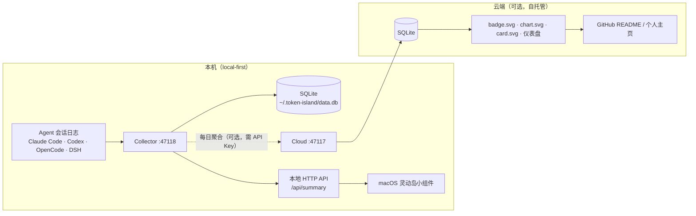

<details>
<summary>ASCII 架构图（mermaid 无法渲染时）</summary>

```text
┌──────────────────────────── 本机（local-first）─────────────────────────────┐
│  Claude Code / Codex / OpenCode / DSH 会话日志                               │
│          │                                                                  │
│          ▼                                                                  │
│  Collector(:47118) ──▶ SQLite(~/.token-island/data.db)                       │
│          │                                                                  │
│          ├──▶ GET /api/summary ──▶ macOS 灵动岛小组件（2s 轮询）              │
│          │                                                                  │
│          └── 每日聚合（可选，云端未启用时不出机器）──┐                        │
└──────────────────────────────────────────────────────┼──────────────────────┘
                                                       ▼
┌──────────────────────────── 云端（可选，自托管）─────────────────────────────┐
│  Cloud(:47117) ──▶ SQLite ──▶ badge.svg / chart.svg / card.svg / dashboard  │
│                                    │                                        │
│                                    └──▶ GitHub README / 个人主页            │
└─────────────────────────────────────────────────────────────────────────────┘
```

</details>

三条不变量：**① 原始日志、`cwd`、项目名、会话 id、prompt 内容只留在本机；② 云端只收到每日聚合数字；③ 云端不可用时 collector 照常工作，同步失败只记录错误、下个周期重试。**

## 快速开始

环境要求：**Node.js >= 22.5**（推荐 22 LTS）、**pnpm 10**；灵动岛需要 **macOS 13+**。

```bash
git clone <repo-url> token-island
cd token-island
pnpm install
```

### 1. 体检

```bash
node bin/tokenisland.mjs doctor
```

体检会检查 Node 版本、依赖、collector/cloud 连通性、灵动岛是否已构建、本机 agent 数据源。真实环境实测输出（服务都在运行时 12 项全绿）：

```text
Token Island doctor
  repo   .../token-island
  state  ~/.token-island

  ✓ node           v22.23.1 (requires >= 22.5)
  ✓ install        tsx 4.23.15, typescript 5.9.3, core linked
  ✓ collector app  apps/collector/src/index.ts
  ✓ cloud app      apps/cloud/src/index.ts
  ✓ collector      http://127.0.0.1:47118/api/health v0.1.0, 104677 events
  ✓ cloud          http://127.0.0.1:47117/healthz, 3 users
  ✓ island         apps/island-macos/build/TokenIsland.app/Contents/MacOS/TokenIsland (1 MB)
  · config         not created yet (using defaults) — ~/.token-island/config.json

  Agent data sources
  ✓ claude         ~/.claude/projects
  ✓ codex          ~/.codex/sessions
  ✓ opencode       ~/.local/share/opencode/opencode.db
  ✓ dsh            ~/.dsh/sessions
  ✓ gemini         ~/.gemini

  12 ok · 0 warnings
```

### 2. 采集本机数据

```bash
node bin/tokenisland.mjs collect --foreground
```

第一次启动会回填最近 30 天（`--backfill-days N` 可调），之后增量扫描。另开终端确认：

```bash
node bin/tokenisland.mjs status
curl -s 'http://127.0.0.1:47118/api/summary?range=today' | head -c 400
```

只想扫一次、或用于 CI / 冒烟测试：

```bash
node bin/tokenisland.mjs collect --once --backfill-days 2
```

实测输出片段（本机真实数据，2 天回填）：

```text
scan: 24460 new events in 7.52s · 24460 events in db · 3 pass(es)
totals (7d): 1.46B tokens · ~$229 · 6421 messages · 36 sessions
top sources: OpenAI Codex 96% · DeepSeek Harness 4.4%
top models:  gpt-6.1-sol 85% · gpt-6-astra 10% · deepseek-flash 4.4%
```

不想读本机真实文件时，用确定性演示模式（不写 SQLite，端口 `:47119`）：

```bash
node bin/tokenisland.mjs collect --demo      # 3168 demo events / 120 天
node bin/tokenisland.mjs status --demo
```

### 3. 安装灵动岛（可选）

```bash
pnpm island:build                     # swift build + 组装 build/TokenIsland.app
node bin/tokenisland.mjs island       # 先直接运行看看（已在跑时会重启）
node bin/tokenisland.mjs install      # 登录自启：灵动岛 + collector 守护进程（无需 sudo）
node bin/tokenisland.mjs uninstall    # 移除两个 LaunchAgent（保留本地数据）
```

`install` 会做两件事，并且是幂等的（重复执行 = 更新配置）：

| 登录项 | LaunchAgent | 说明 |
| --- | --- | --- |
| 灵动岛 | `com.token-island.app` | `TokenIsland.app` 复制到 `~/Applications`，登录后显示 |
| 采集守护 | `com.token-island.collector` | `RunAtLoad` + `KeepAlive`，登录即开始采集；日志在 `<repo>/.runtime/collector/daemon.log` |

> `install --dry-run` 只打印将要写入的 plist 与文件位置，不做任何修改。生产状态目录仍是 `~/.token-island`；安装时若显式设置了 `TOKEN_ISLAND_HOME`，会写入守护进程环境。

### 4. 启动云端（可选）

```bash
node bin/tokenisland.mjs cloud seed     # 可选：写入 demo / alice 演示数据，打印示例 URL 与 API Key
node bin/tokenisland.mjs cloud start    # 终端 A：HTTP 服务，默认 :47117
```

终端 B：

```bash
# 注册自己的用户名，API Key 会原子写入 ~/.token-island/config.json（权限 600）
node bin/tokenisland.mjs register --cloud http://127.0.0.1:47117 --username <你的名字>

# 把当前每日聚合推送到云端一次（collector 在跑时会自动同步；手动同步也随时可用）
node bin/tokenisland.mjs sync

open http://127.0.0.1:47117/u/<你的名字>
```

`register` 实测输出：

```text
✓ registered <你的名字> at http://127.0.0.1:47117
  API key   ti_…  (shown once — store it now)
  Config    ~/.token-island/config.json (mode 600, existing keys preserved)
  Badge     http://127.0.0.1:47117/u/<你的名字>/badge.svg?metric=tokens&theme=dark
  Dashboard http://127.0.0.1:47117/u/<你的名字>
```

`sync` 后用 `GET /api/v1/me`（Bearer API Key）可核对云端数据，实测同步后 `days=67`、累计 token / 成本与本地一致。

### 5. 一条命令验证整条链路

```bash
pnpm dev     # 同时启动 dev collector(:47121) + dev cloud(:47120)，状态在 .runtime/dev，Ctrl+C 干净退出
pnpm e2e     # 完整端到端验收：typecheck + tests → collector demo API → cloud seed/SVG/dashboard → 灵动岛快照
```

`pnpm e2e` 实测结果：**24 passed · 0 failed · 0 skipped**。它使用专属端口（`:47120` cloud / `:47121` collector demo，可用 `E2E_CLOUD_PORT` / `E2E_COLLECTOR_PORT` 覆盖），不会碰你正在跑的生产服务（`:47117` / `:47118`）。

## GitHub README 徽章 / 图表

云端把每日聚合渲染成**纯手写 SVG**：没有外部字体、脚本和图片，GitHub README 可直接引用。两种用法：

### 方式 A：公网部署，使用实时 SVG URL

把云端部署到公网（见下方「云端部署」），README 里直接引用：

```html


```

每次 sync 后自动更新。注意：**`http://127.0.0.1:47117` 这类本地地址无法被 github.com 访问**，只能在本地浏览器预览。

### 方式 B：导出静态 SVG 并提交（无需公网部署，本仓库 README 采用）

```bash
node bin/tokenisland.mjs export --cloud http://127.0.0.1:47117 --user <你的名字> \
  --out docs/badges --days 30
```

命令会下载 7 种徽章 + 4 种图表 + 名片（实测 `12/12 SVG files`），并打印可直接粘贴的 Markdown（仓库相对路径）：

```markdown


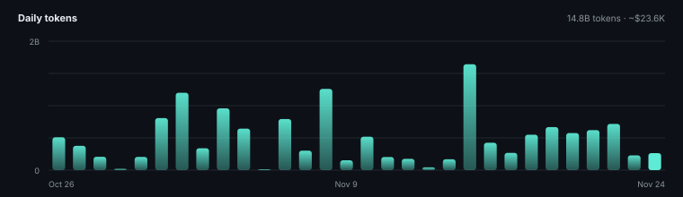
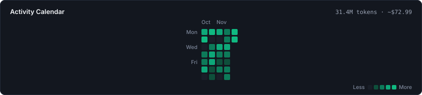
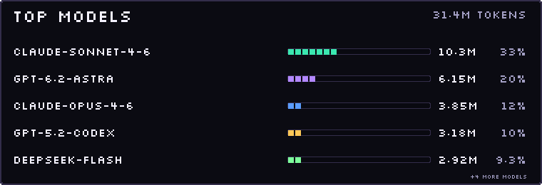

```

本 README 下方展示的就是 `docs/badges/` 中真实导出的静态文件（数据是导出时刻的快照；再次 `sync` 后重新 `export` 即可刷新）：

      


### 徽章指标与参数

| `metric=` | 含义 | 默认窗口 |
| --- | --- | --- |
| `tokens` | 区间总 token 数 | 30 天 |
| `cost` | 估算花费（如 `~$23.6K`） | 30 天 |
| `streak` | 连续活跃天数（如 `49d`） | 当前 streak |
| `messages` | agent 回合数（如 `105K`） | 30 天 |
| `day` | 今日 token | 今天 |
| `model` | 消耗最高的模型（截断 22 字符） | 30 天 |
| `status` | `live` / `idle`（24 小时内是否同步） | 最近同步 |

通用参数：`theme=dark|light|auto`、`label=<自定义左标签>`、`days=1..365`、`style=flat|flat-square`。

| 组件 | 路由 | 参数 |
| --- | --- | --- |
| 徽章 | `/u/:user/badge.svg` | `metric`、`theme`、`label`、`days`、`style` |
| 折线/柱状/热力/模型图 | `/u/:user/chart.svg` | `type=line / bar / heatmap / models`、`days=7..365`、`theme`、`width`、`height` |
| 名片 | `/u/:user/card.svg` | `theme`、`width`（默认 495） |
| 仪表盘 | `/u/:user` | `?theme=dark / light` |
| JSON 统计 | `/api/v1/u/:user` | 公开只读 |

## 云端部署

云端是单文件 SQLite + `node:http` 的零依赖 Node 服务，可部署到任意容器平台。`apps/cloud/` 内置 `Dockerfile`（构建上下文为**仓库根目录**）、`railway.json` 和 `apps/cloud/DEPLOY.md`。

```bash
# 在仓库根目录构建
docker build -f apps/cloud/Dockerfile -t token-island-cloud .

docker run -d --name token-island -p 8080:8080 \
  -v token-island-data:/data \
  -e TOKEN_ISLAND_ADMIN_TOKEN="$(openssl rand -hex 24)" \
  token-island-cloud

# 可选：写入 demo/alice 演示数据（打印 API Key 与示例 URL）
docker exec -it token-island node --import tsx apps/cloud/src/seed.ts
```

Railway：从本仓库创建项目（自动读取 `railway.json`，Dockerfile 构建、`/healthz` 健康检查），**挂载 volume 到 `/data`**，然后设置下表变量（详细步骤见 [apps/cloud/DEPLOY.md](apps/cloud/DEPLOY.md)）：

| 环境变量 | 默认值 | 说明 |
| --- | --- | --- |
| `PORT` | `47117`（Docker 内 `8080`） | 服务监听端口 |
| `HOST` | `0.0.0.0` | 监听地址 |
| `TOKEN_ISLAND_CLOUD_DB` | `./data/cloud.db`（容器内 `/data/cloud.db`） | SQLite 路径；SQLite 单写者，**副本数保持 1** |
| `TOKEN_ISLAND_ADMIN_TOKEN` | 空 | 设置后 `POST /api/v1/register` 需要 `Authorization: Bearer <token>` |
| `TOKEN_ISLAND_ALLOW_REGISTER` | `1` | `0` 关闭公开注册 |
| `TOKEN_ISLAND_PUBLIC_URL` | 从请求推断 | 生成的嵌入片段使用的公网地址 |

## CLI 参考

所有命令：`node bin/tokenisland.mjs <command>`。嫌长可以 `alias ti="node $PWD/bin/tokenisland.mjs"`。单命令帮助：`node bin/tokenisland.mjs help <command>`。

| 命令 | 说明 |
| --- | --- |
| `collect [--foreground] [--once] [--demo] [--reset] [--backfill-days N]` | 运行 collector；`--once` 扫一次即退出，`--demo` 演示数据监听 `:47119`，`--reset` 重建数据库 |
| `sync` | 手动把每日聚合推送云端一次（不需要 collector 在跑） |
| `status [--port N] [--demo]` | 打印 collector `/api/health` JSON；离线时打印 `offline` 并返回非 0 |
| `register --cloud <url> --username <name>` | 注册云端账号并原子写入 API Key（`600` 权限） |
| `export [--cloud <url>] [--user <name>] [--out docs/badges] [--days 30] [--theme dark]` | 导出静态 SVG，供 GitHub README 使用 |
| `cloud start [--port N] [--db <path>]` / `cloud seed [--db <path>]` | 启动云端 / 写入幂等演示数据 |
| `island [--snapshot <out.png>] [--snapshot-all <dir>] [--demo]` | 启动灵动岛；快照模式渲染 PNG 后退出（`--state collapsed / expanded / offline`、`--scale 2`、`--background wallpaper / transparent`、`--fixture <summary.json>`） |
| `install [--dry-run]` / `uninstall [--dry-run]` | 安装/卸载灵动岛 + collector 两个 LaunchAgent（无需 sudo） |
| `doctor` | 体检：Node、依赖、服务连通性、灵动岛构建、数据源；输出 ✓/✗ 表 |
| `help [command]` | 全局或单命令帮助 |

## 配置说明

配置位于 `~/.token-island/config.json`（可用 `TOKEN_ISLAND_HOME` 覆盖目录），collector / 灵动岛 / CLI 共享。所有键都可省略：

```jsonc
{
  "port": 47118,
  "timezone": "auto",                 // "auto" = 系统时区，或 IANA id（如 "Asia/Singapore"）
  "backfillDays": 30,                 // 只扫描最近 N 天修改过的会话文件
  "scanIntervalMs": 2000,
  "liveWindowMs": 600000,             // 10 分钟内有事件的会话视为活跃
  "sources": { "claude": true, "codex": true, "opencode": true, "dsh": true, "gemini": false },
  "paths": {                          // 可选：覆盖数据源目录，~ 会展开
    "claude": "~/.claude",
    "codex": "~/.codex",
    "opencode": "~/.local/share/opencode",
    "dsh": "~/.dsh"
  },
  "prices": [                         // 覆盖/扩展内置价目表，单位：USD / 1M tokens
    { "match": "my-internal-model", "input": 0.5, "output": 1.5 }
  ],
  "cloud": {
    "enabled": false,
    "url": "http://127.0.0.1:47117",
    "username": "leonezz",
    "apiKey": "ti_...",
    "autoSync": true,
    "intervalMinutes": 15
  }
}
```

> 示例中的注释仅用于说明；实际 `config.json` 必须是合法 JSON。`register` 会保留已有键、只合并 `cloud.*`，并以原子写入 + `chmod 600` 保护 API Key。

| 环境变量 | 作用 |
| --- | --- |
| `TOKEN_ISLAND_HOME` | 状态目录（默认 `~/.token-island`）：`config.json`、`data.db` |
| `TOKEN_ISLAND_PORT` | collector 端口覆盖（默认 47118；`--demo` 固定 47119） |
| `TOKEN_ISLAND_CONFIG` | 灵动岛读取的配置文件路径（默认 `~/.token-island/config.json`） |
| `TOKEN_ISLAND_FIXTURE` | 灵动岛演示模式使用的 `Summary` JSON |
| `PORT` / `HOST` | 云端监听端口（默认 47117）/ 地址（默认 0.0.0.0） |
| `TOKEN_ISLAND_CLOUD_DB` | 云端 SQLite 路径（默认 `./data/cloud.db`） |
| `TOKEN_ISLAND_ADMIN_TOKEN` | 云端注册管理员令牌 |
| `TOKEN_ISLAND_ALLOW_REGISTER` | `0` 关闭云端公开注册 |
| `E2E_CLOUD_PORT` / `E2E_COLLECTOR_PORT` | `pnpm e2e`、`pnpm dev` 使用的专属端口（默认 47120 / 47121） |

端口一览：换端口时记得 CLI、灵动岛和云端三边一致。

| 场景 | collector | cloud |
| --- | --- | --- |
| 生产/本机默认 | `127.0.0.1:47118` | `0.0.0.0:47117` |
| collector 演示模式 | `127.0.0.1:47119` | — |
| `pnpm dev` / `pnpm e2e` | `47121` | `47120` |

## 数据源与隐私

| Agent | 默认路径 | 解析要点 |
| --- | --- | --- |
| Claude Code | `~/.claude/projects/**/*.jsonl` | `message.usage`；按 `message.id` 去重（同一条消息会约出现 2 次）；300MB+ 文件流式读取 |
| OpenAI Codex | `~/.codex/sessions/**/rollout-*.jsonl` | `token_count.last_token_usage` 每轮增量；缓存 token 从 input 中扣除 |
| OpenCode | `~/.local/share/opencode/opencode.db` | 只读打开，按 message id 去重；优先采用 OpenCode 已算好的 cost |
| DeepSeek Harness | `~/.dsh/sessions/*/*/session.v4.jsonl.zstd` | 多帧 zstd（调用 `zstd -dc`）；小文件按 `(size, mtime)` 变化重解析 |

- **只读本地文件**：collector 只读取上述日志，写入自己的 `~/.token-island/data.db`。
- **云端只收到每日聚合**：`CloudDay = { date, 各类 token 数, costUsd, messages, models }`，不含 prompt 内容、绝对路径、项目名、会话 id。
- **本地 API 只监听 `127.0.0.1`**；CORS 放开仅用于本机页面/小组件读取只读数据。
- **默认不上传**：`cloud.enabled=false` 时数据不会离开本机；执行 `register` 后才启用同步。
- **API Key 只返回一次**：云端只保存 sha256；本地明文只存在于权限 `600` 的 `config.json`。
- **可随时关闭/删除**：`sources` 里设为 `false` 关闭单个数据源；停止 collector 后删除 `~/.token-island/` 即可清空本地数据；云端 profile 页可通过 `robots.txt` 阻止被搜索引擎索引。

## 定价免责声明

- 展示的成本是**按公开价目表估算**的美元金额（USD / 1M tokens），用于自我感知与横向比较，**不是账单**，也不构成费用承诺。
- 缓存读写、推理 token、批处理折扣、订阅套餐、区域价格等各家计费规则不同且会变化，估算与实际账单可能有偏差。
- 无法匹配价目表的模型会计入 `unpricedTokens` 且**不计入成本**（界面会提示）。
- 可以在 `config.json` 的 `prices` 中覆盖或补充价格；发现内置价目过时可以提 issue/PR。

## 验证状态

本仓库当前实测通过：

```text
pnpm typecheck   ✓ 3/3 packages（core / collector / cloud）
pnpm test        ✓ 76 tests（core 25 · collector 29 · cloud 22）
pnpm e2e         ✓ 24 passed · 0 failed · 0 skipped
```

`pnpm e2e` 依次验证：core typecheck + tests → collector demo API（`/api/health`、`/api/summary` 结构、`today.totalTokens > 0`）→ cloud seed + `/healthz` + 3 种徽章 + 3 种图表 + 名片 + dashboard HTML → 灵动岛 2x 快照。所有子进程都有超时上限并在结束时清理，缺失应用会明确 SKIP 而不是崩溃。

> 灵动岛截图的生成：`bash scripts/snapshot-island.sh`（重新生成 fixtures 并渲染 `docs/images/island-*.png`）；云端截图由 headless Chrome 从本地 demo cloud 渲染。Docker/Railway 部署步骤来自 [apps/cloud/DEPLOY.md](apps/cloud/DEPLOY.md) 并在云端镜像构建配置中固定，本次验收未在本机运行容器。

## FAQ

**Q：`doctor` 显示 collector / cloud 是 ✗？**
它们是服务，不是常驻进程。先 `node bin/tokenisland.mjs collect --foreground` / `cloud start`，或直接 `node bin/tokenisland.mjs install` 让两者登录自启，再重新体检。

**Q：采集到的 token 数是 0 / 比预期少？**
确认对应 agent 的日志目录存在且最近 `backfillDays` 天内用过；`doctor` 会列出每个数据源是否存在。需要更早数据：`node bin/tokenisland.mjs collect --reset --backfill-days 90`。

**Q：端口被占用怎么办？**
collector 用 `TOKEN_ISLAND_PORT=47120`（灵动岛同环境变量）；云端用 `PORT=...` 或 `cloud start --port N`。`pnpm e2e` / `pnpm dev` 默认就用专属的 `:47120` / `:47121`，不会和默认端口冲突。

**Q：只想追踪一个 agent 可以吗？**
可以，把其他 `sources` 设为 `false`；不存在的日志目录会自动跳过、不报错。

**Q：数据会上传云端吗？**
默认不会。只有 `register` 写入 API Key 且 `cloud.enabled=true` 后，collector 才会按 `intervalMinutes` 推送**每日聚合**；把 `enabled` 改回 `false` 立即停止。

**Q：GitHub README 里的图片不显示？**
github.com 无法访问 `127.0.0.1`。要么把云端部署到公网用实时 URL（方式 A），要么用 `tokenisland export` 导出静态 SVG 并提交（方式 B）。

**Q：安装/卸载对系统做了什么？**
`install` 只写 `~/Applications/TokenIsland.app` 和两个用户级 LaunchAgent（`com.token-island.app`、`com.token-island.collector`），不需要 sudo；`uninstall` 卸载它们并保留 `~/.token-island` 数据。`--dry-run` 可先预览。

**Q：演示模式会污染真实数据吗？**
不会。`collect --demo` 不写 SQLite，只在内存中服务 `:47119`；`island --demo` 使用内置 `fixtures/summary.example.json`。

**Q：e2e 太慢 / 只想跑集成部分？**
`node --import tsx scripts/e2e.ts --skip-core-tests`（跳过 core typecheck + tests）。

## 目录结构

```text
token-island/
├── bin/tokenisland.mjs          # 零依赖 CLI 入口（collect/sync/register/export/doctor/install…）
├── packages/core/               # 共享类型、定价、聚合、格式化（纯函数 + 25 个测试）
├── apps/collector/              # 采集守护进程：日志解析 → SQLite → 本地 API → 云同步
├── apps/cloud/                  # 云端：注册/ingest + SVG 徽章/图表/名片/仪表盘 + Dockerfile/railway.json/DEPLOY.md
├── apps/island-macos/           # SwiftUI 灵动岛（NSPanel、菜单栏、快照渲染、LaunchAgent 安装脚本）
├── fixtures/                    # 确定性演示数据（summary/events/cloud-days）
├── scripts/                     # dev / e2e / snapshot-island / gen-fixtures
├── docs/CONTRACT.md             # 各模块接口与验收契约
├── docs/ARCHITECTURE.md         # 架构、失败处理与扩展指南
├── docs/images/                 # README 截图（灵动岛 + 云端渲染）
├── docs/badges/                 # tokenisland export 生成的静态 SVG（GitHub 可直接引用）
└── README.md
```

## Roadmap

- [x] Collector：多数据源增量解析 + SQLite + 本地 HTTP API + 云同步
- [x] 灵动岛：收起/展开/离线三态、菜单栏、快照渲染、登录自启
- [x] 云端：注册/ingest、7 种徽章、4 种图表、名片、dashboard/landing
- [x] `tokenisland` CLI：collect/sync/status/register/export/doctor/install/uninstall
- [ ] 更多数据源（Gemini CLI、Cursor 等）
- [ ] 预算/限额提醒（今日超支高亮、系统通知）
- [ ] 多机 / 团队聚合视图
- [ ] Windows / Linux 桌面小组件
- [ ] 一键部署模板（Railway / Fly.io / Docker Compose）
- [ ] 实时同步（SSE 增量推送，替代 2s 轮询）

## License

[MIT](LICENSE)

---

文档索引：[docs/CONTRACT.md](docs/CONTRACT.md)（模块接口契约） · [docs/ARCHITECTURE.md](docs/ARCHITECTURE.md)（架构与扩展） · [apps/cloud/DEPLOY.md](apps/cloud/DEPLOY.md)（云端部署）
