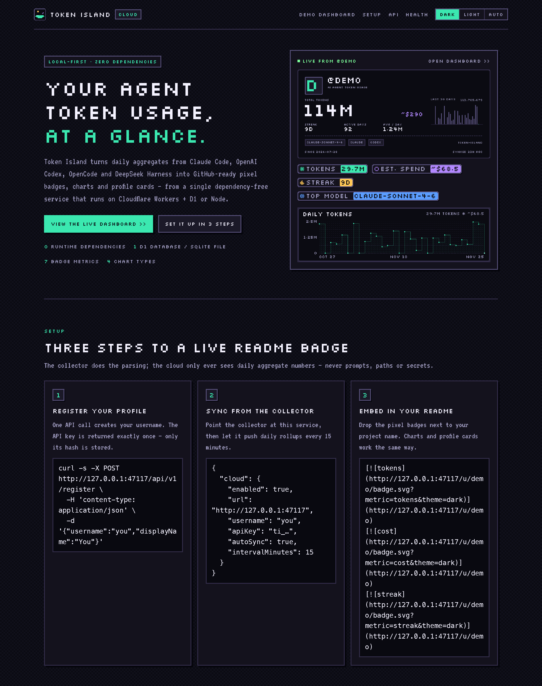
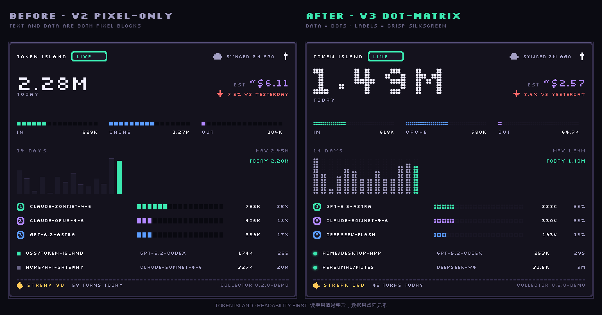
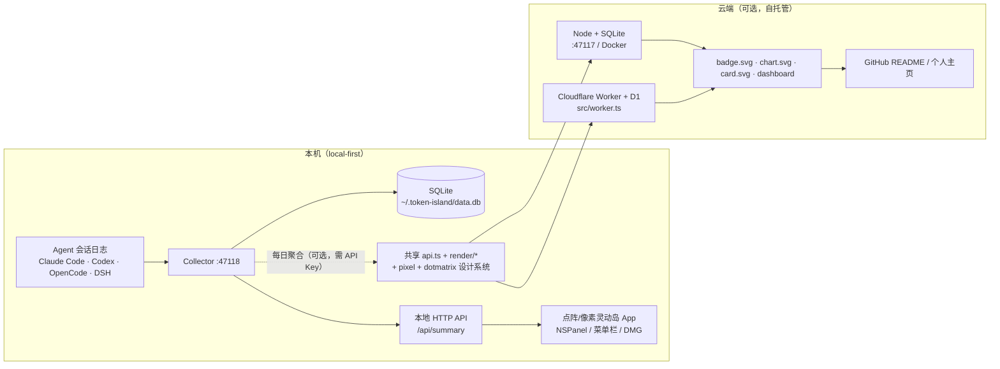
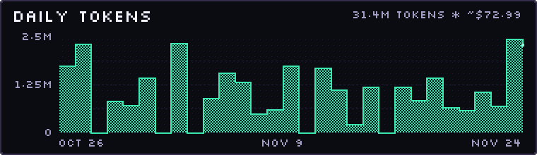

# Token Island

> **本地优先的 AI Coding Agent Token 追踪器**：像素/点阵风 macOS 灵动岛实时显示今天花了多少 token，云端生成 GitHub README 徽章、图表和名片；V3 起遵循「读字用清晰字形，数据用点阵元素」。云端支持 **Cloudflare Workers + D1** 与 **Node + SQLite** 双运行时。


<p align="center">
  
</p>

<p align="center">
  
  
</p>

## V2 → V3：像素底座上的选择性点阵

**V2（0.2.0）** 是一次完整重制：

- **像素设计系统**：`packages/core/src/pixel.ts` 统一调色板、Silkscreen 位图字体、阶梯切角、2px 硬边框、棋盘抖动、像素精灵；App / SVG / HTML 全部同源，所有坐标是整数，无渐变无圆角（原生窗口形状除外）。
- **真原生 macOS App**：AppIcon、DMG 安装包、About/Preferences 原生窗口、菜单栏图标、登录自启；`hdiutil verify` 通过，ad-hoc codesign 有效。
- **双运行时云端**：生产目标 **Cloudflare Workers + D1**（`src/worker.ts`、`wrangler.toml`、`migrations/`）；本地开发 / Docker / 测试保留 **Node + SQLite**（`src/node.ts`）。两条运行时共享同一套路由、校验、统计与渲染代码。

**V3（0.3.0）** 是一次“局部替换”的阅读性升级，不是重做：

- **`packages/core/src/dotmatrix.ts`**：点阵渲染 API（`dotFigureSvg` / `dotColumnsSvg` / `dotSparklineSvg` / `dotRatioStripSvg` / `dotLedSvg` / `dotTextureSvg` / `dotTextSvg`），**只有 LED 状态点带光晕**。
- **灵动岛**：hero 今日 token 数字、14 天图表、收起态 sparkline、IN/CACHE/OUT 比例条、模型比例条、状态 LED 换成点阵；hero 数字由 SwiftUI `Canvas` + `pixel-glyphs.json` 绘制，Reduce Motion/加载失败时回退 V2 文字。所有标签/模型名/项目名/footer 保持 Silkscreen 位图字形，字号与对比度不变。
- **云端**：图表数据标记点阵化（line = 圆点 + 阶梯连线、bar = 点柱、models = 点阵段、heatmap 保留方块 + 点阵 legend）；徽章文字不变，左侧图标改点阵并加 0.10 点纹理；dashboard 统计卡片大数字为点阵 SVG。其余排版与文字不变。
- **验证结果**：`pnpm test` **109 个测试**（core 47 · collector 29 · cloud 33）；`pnpm e2e` **89 项断言 0 failed 0 skipped**（Node 云端 + Cloudflare Worker 点阵断言、灵动岛快照几何）。

## 为什么做这个

同时使用 Claude Code、OpenAI Codex、OpenCode、DeepSeek Harness 时，**token 消耗分散在各个 agent 的会话日志里，无从感知**：

- 每个 agent 各写各的日志，没有一个地方能回答「我今天到底用了多少 token」；
- 供应商后台只按账号/账单汇总，看不到是哪个模型、哪个时段在消耗；
- 等月底看到账单才后知后觉，已经很难回头调整用法；
- 想放进 GitHub 主页或 README，却没有现成、好看、可自动更新的组件。

Token Island 把这件事拆成三层，**全部可以只在本地运行**：

1. **Collector**：增量解析本机 agent 会话日志，归一化后写入 SQLite，暴露本地 HTTP API；
2. **Dynamic Island（灵动岛）**：像素风原生 macOS 小组件，悬浮在刘海/屏幕顶部，2 秒刷新；
3. **Cloud**：只接收**每日聚合**数据，渲染像素风 SVG 徽章、图表、名片和 dashboard。

## 核心特性

- **多 agent 统一口径**：Claude Code / OpenAI Codex / OpenCode / DeepSeek Harness 统一为 `UsageEvent`（输入、输出、缓存读、缓存写、推理 token 与估算成本）；单个 source 出错不影响整体。
- **本地优先**：原始日志从不离开本机；collector 只监听 `127.0.0.1`。
- **增量 & 幂等**：按文件 offset 增量读取、事件 id 去重，重启/重复扫描不会重复计数，大文件流式解析。
- **像素风三态灵动岛**：收起 224×44 / 展开 448×400 / 离线琥珀外壳；今日 token、成本、趋势、输入/缓存/输出分段条、14 天柱状图、Top 模型、活跃会话、streak。
- **原生 macOS 体验**：菜单栏像素图标、About 窗口、Preferences（端口 / 刷新间隔 / 登录自启 / 打开 dashboard）、无 Dock 图标、不抢焦点。
- **GitHub README 组件**：7 种像素 `badge.svg` 指标、4 种 `chart.svg`（line / bar / heatmap / models）、`card.svg` 名片、带可复制嵌入代码的 pixel dashboard / landing page。
- **零运行时依赖**：Node 内置模块 + macOS 原生 SwiftUI；Worker 侧只用 Web API + D1。
- **可离线演示**：`collect --demo` 提供确定性演示数据；灵动岛 `--demo` 加载内置 fixture。

## 云端点阵输出（V3）

<p align="center">
  <picture>
    <source media="(prefers-color-scheme: dark)" srcset="docs/images/badges-dark.png">
    <source media="(prefers-color-scheme: light)" srcset="docs/images/badges-light.png">
    
  </picture>
</p>

<p align="center">
  <picture>
    <source media="(prefers-color-scheme: dark)" srcset="docs/images/dashboard-dark.png">
    <source media="(prefers-color-scheme: light)" srcset="docs/images/dashboard-light.png">
    
  </picture>
</p>

<table>
<tr>
<td width="50%"></td>
<td width="50%"></td>
</tr>
<tr>
<td></td>
<td></td>
</tr>
</table>

<p align="center">
  
  
</p>

<details>
<summary>移动端 dashboard（390px 视口）</summary>

<p align="center">
  
</p>

</details>

> 云端截图来自运行中的 V3 云端（演示数据 + 本机真实同步数据）；灵动岛真实数据图见 `docs/images/island-expanded-real.png`。所有图片由真实构建/服务渲染，只有点阵改造前后对比图是两张截图的排版合成。

## 点阵元素的使用边界

V3 的核心原则只有一句：**读字用清晰字形，数据用点阵元素**。改造前后对比如下（左：V2 全像素；右：V3 点阵数据 + 清晰文字）：

<p align="center">
  
</p>

| 点阵元素（数据/装饰） | 保持清晰位图字形（文字，V2 同款 Silkscreen） |
| --- | --- |
| 灵动岛 hero 今日 token 大数字（≥24px，无 blur / 扫描线） | TOKEN ISLAND / TODAY / 14 DAYS / IN · CACHE · OUT / MAX 等全部标签 |
| 14 天图表（点阵柱）、收起态 sparkline（点阵柱） | 所有模型名、项目名、相对时间、footer、按钮文字 |
| IN/CACHE/OUT 分段比例条、Top models 比例条（点阵段） | 坐标轴标签、图例文字、空数据状态文字 |
| 实时状态 LED（≤8px，2 圈光环；**唯一允许光晕的地方**） | 所有数字与文字不加光晕，字号不小于 V2 |
| 云端图表数据标记：line 圆点 + 阶梯连线、bar 点柱、models 点阵段、heatmap 保留方块 + 点阵 legend | 图表标题 / 轴标签 / 模型名 / 表格 / 页脚 / 嵌入代码 |
| 徽章左侧点阵图标 + label 区 `opacity 0.10` 极淡纹理 | 徽章 label/value 文字保持位图字形（light/dark 对比度均 ≥4.5:1） |
| dashboard 统计卡片大数字（≥40px）、≤2 处/页的细点状分隔线 | dashboard 其余文字、数字说明、表格、嵌入片段 |

硬性可读性规则（不达标就回退 V2 文字渲染）：

- 点阵数字只允许出现在 **≥24px 高**的位置；禁止用于标签、正文、模型名、任何 **<16px** 的信息文本。
- 图表仍必须有位图文字的轴标签与空数据提示；LED 光晕只出现在 ≤8px 状态点。
- SVG 仍自包含、无外部字体、无 `<text>`、XML 合法；徽章文字不会因为点阵化而降低对比度。

## 架构



<details>
<summary>ASCII 架构图（mermaid 无法渲染时）</summary>

```text
┌──────────────────────────── 本机（local-first）─────────────────────────────┐
│  Claude Code / Codex / OpenCode / DSH 会话日志                               │
│          │                                                                  │
│          ▼                                                                  │
│  Collector(:47118) ──▶ SQLite(~/.token-island/data.db)                       │
│          │                                                                  │
│          ├──▶ GET /api/summary ──▶ 像素灵动岛 App（NSPanel + 菜单栏）         │
│          │                                                                  │
│          └── 每日聚合（可选，云端未启用时不出机器）──┐                        │
└──────────────────────────────────────────────────────┼──────────────────────┘
                                                       ▼
┌──────────────────────── 云端（共享像素渲染代码）────────────────────────────┐
│   api.ts + render/* + packages/core/pixel.ts                                │
│      ├──▶ Node + SQLite (:47117, Docker/Railway)                            │
│      └──▶ Cloudflare Worker + D1 (src/worker.ts, wrangler)                  │
│                       │                                                     │
│                       └──▶ badge.svg / chart.svg / card.svg / dashboard     │
│                                   └──▶ GitHub README / 个人主页             │
└─────────────────────────────────────────────────────────────────────────────┘
```

</details>

三条不变量：**① 原始日志、`cwd`、项目名、会话 id、prompt 内容只留在本机；② 云端只收到每日聚合数字；③ 云端不可用时 collector 照常工作，同步失败只记录错误、下个周期重试。**

## 快速开始

环境要求：**Node.js >= 22.5**（推荐 22 LTS）、**pnpm 10**；原生 App 需要 **macOS 13+**。Cloudflare 部署额外需要 `wrangler`（`npm i -g wrangler@4`）与 Cloudflare 账号；Docker 部署需要 Docker。

```bash
git clone <repo-url> token-island
cd token-island
pnpm install
```

### 1. 体检

```bash
node bin/tokenisland.mjs doctor
```

V2 的 doctor 会额外检查像素 App 资源、DMG、codesign 与 wrangler。真实环境实测（服务都在运行时 **17 ok · 0 warnings**）：

```text
Token Island doctor
  ✓ node           v22.23.1 (requires >= 22.5)
  ✓ install        tsx 4.23.15, typescript 5.9.3, core linked
  ✓ collector app  apps/collector/src/index.ts
  ✓ cloud app      apps/cloud/src/node.ts + worker.ts (Cloudflare)
  ✓ collector      http://127.0.0.1:47118/api/health v0.3.0, 106885 events
  ✓ cloud          http://127.0.0.1:47117/healthz, 3 users
  ✓ wrangler       wrangler v4.120.1
  · worker port    :47131 free (tokenisland cloud dev)
  ✓ island         apps/island-macos/build/TokenIsland.app/Contents/MacOS/TokenIsland (1 MB)
  ✓ app assets     AppIcon.icns + Silkscreen fonts/OFL licenses bundled
  ✓ dmg            apps/island-macos/build/TokenIsland-0.3.0.dmg (0.4 MB)
  ✓ codesign       ad-hoc signature valid (codesign --verify --deep --strict)
  · config         not created yet (using defaults) — ~/.token-island/config.json
  ✓ claude · codex · opencode · dsh · gemini 数据源均存在
```

### 2. 采集本机数据

```bash
node bin/tokenisland.mjs collect --foreground
```

首次启动回填最近 30 天（`--backfill-days N` 可调），之后增量扫描。另开终端确认：

```bash
node bin/tokenisland.mjs status
curl -s 'http://127.0.0.1:47118/api/summary?range=today' | head -c 400
```

只想扫一次 / 冒烟测试：

```bash
node bin/tokenisland.mjs collect --once --backfill-days 2
```

不读本机真实文件时用确定性演示数据（不写 SQLite，端口 `:47119`）：

```bash
node bin/tokenisland.mjs collect --demo
node bin/tokenisland.mjs status --demo
```

### 3. 安装像素风原生 App（V3 点阵 hero）

**方式 A：DMG 安装（推荐给最终用户）**

```bash
pnpm island:build                              # 构建 .app（swift build + 资源 + ad-hoc codesign）
bash apps/island-macos/scripts/package-dmg.sh  # 生成 UDZO 安装包并 hdiutil verify
node bin/tokenisland.mjs island --dmg          # 打印 DMG 路径、校验结果与安装步骤
```

`island --dmg` 实测输出：

```text
✓ Token Island DMG: apps/island-macos/build/TokenIsland-0.3.0.dmg (0.4 MB)
✓ hdiutil verify: VALID

Install from the DMG
  1. open apps/island-macos/build/TokenIsland-0.3.0.dmg
  2. drag Token Island.app into /Applications
  3. launch it — the island appears at the top of the screen
```

安装后：

- **菜单栏像素图标**：Show/Hide Island、Open Dashboard、Sync Cloud Now、Preferences…、About Token Island、Quit（无 Dock 图标，`LSUIElement`）。
- **Preferences（⌘,）**：collector 端口、刷新间隔（1s/2s/5s）、**Launch at login** 开关（写入 / 移除 LaunchAgent）、打开 dashboard、版本与数据路径。
- **About**：图标、版本、GitHub / MIT 信息。
- App 为 **ad-hoc 签名、未 notarize**；若首次启动被 Gatekeeper 拦截，右键 → Open，或本地自行构建。V3 的 hero 大数字是点阵绘制，但 `TODAY`/成本/模型名等文字仍是清晰 Silkscreen。

**方式 B：CLI 安装（同时装 App 与 collector 守护）**

```bash
node bin/tokenisland.mjs install --dry-run   # 只打印计划，不写文件
node bin/tokenisland.mjs install             # 写入 ~/Applications + 两个 LaunchAgent（无需 sudo）
node bin/tokenisland.mjs uninstall           # 移除登录项（保留 ~/.token-island 数据）
```

会安装两个用户级 LaunchAgent：`com.token-island.app`（灵动岛）与 `com.token-island.collector`（采集守护，`RunAtLoad` + `KeepAlive`，日志在 `<repo>/.runtime/collector/daemon.log`）。

**开发者直接运行 / 渲染截图**：

```bash
node bin/tokenisland.mjs island                     # 直接启动构建好的 app
node bin/tokenisland.mjs island --snapshot docs/images/island-expanded.png \
  --state expanded --scale 2 --background wallpaper
node bin/tokenisland.mjs island --snapshot-all .runtime/island-shots --scale 2
bash scripts/snapshot-island.sh --no-fixtures --real .runtime/real-summary.json
```

App 图标（`assets/appicon/AppIcon.icns`，512px 预览）：

<p align="left">
  
</p>

### 4. 本地运行云端（Node + SQLite）

```bash
node bin/tokenisland.mjs cloud seed      # 可选：写入 demo / alice 演示数据（打印 API Key 与 URL）
node bin/tokenisland.mjs cloud start     # 终端 A：Node 运行时，默认 :47117
```

终端 B：

```bash
# 注册用户名：API Key 原子写入 ~/.token-island/config.json（权限 600）
node bin/tokenisland.mjs register --cloud http://127.0.0.1:47117 --username <你的名字>

# 同步每日聚合（collector 在跑时会自动同步；手动也随时可用）
node bin/tokenisland.mjs sync

open http://127.0.0.1:47117/u/<你的名字>
```

实测同步后 `/api/v1/me`：`days=67`、累计 **6,958,091,515 tokens**、估算 **~$11,289**、24,950 条回合、49 天 streak，与本地 collector 数据一致。

### 5. 一条命令验证整条链路

```bash
pnpm dev     # 同时启动 dev collector(:47121) + dev cloud(:47120)，状态在 .runtime/dev，Ctrl+C 干净退出
pnpm e2e     # 完整验收：typecheck + tests → collector → Node cloud → Cloudflare Worker → 灵动岛快照
```

`pnpm e2e` 实测：**89 passed · 0 failed · 0 skipped**。它会：

1. 跑根目录 `pnpm typecheck` + `pnpm test`；
2. 在 `:47121` 起 collector demo，断言 `/api/health` 与 `/api/summary` 结构；
3. 在 `:47120` 起 Node 云端 + 临时 SQLite，断言 seed、点阵徽章/图表/名片（图表 `<circle>` 数据点、无 `<text>`、`crispEdges`、2px 边框）与 dashboard 点阵统计数字；
4. 在 `:47131` 起 **Cloudflare Worker（本地 D1 迁移 + `wrangler dev`）**，通过 HTTP 注册/ingest 后断言点阵 SVG（图表含 `<circle>` 数据点、徽章含点阵图标与 0.10 纹理、仍然无 `<text>`）；`wrangler` 缺失时干净 SKIP；
5. 用 `--snapshot-all` 渲染点阵灵动岛快照并校验 224×44 / 448×400（scale 2）几何 + 1920×1200 壁纸画布；
6. 所有子进程（含 `wrangler dev` 的 workerd）在结束时清理，端口可用 `E2E_*_PORT` 覆盖。

## 云端部署

云端有两种运行时，**同一套代码、同一套像素渲染**，按场景选择：

| 运行时 | 入口 | 存储 | 适合 |
| --- | --- | --- | --- |
| **Cloudflare Workers + D1** | `src/worker.ts` | D1 binding `DB` | **生产目标**，全球边缘、免运维 |
| **Node + SQLite** | `src/node.ts` | `node:sqlite` 文件 | 本地开发、Docker、Railway、测试 |

### A. Cloudflare Workers + D1（生产推荐）

前置：Cloudflare 账号、`npm i -g wrangler@4`（本次验证使用 4.120.1）。

```bash
wrangler login                                  # 或 export CLOUDFLARE_API_TOKEN=...

# 1. 创建 D1，把打印的 database_id 填进 apps/cloud/wrangler.toml
wrangler d1 create token-island-cloud

# 2. 应用 schema（远程 D1）
wrangler d1 migrations apply token-island-cloud --remote

# 3. 本地 bundle/bindings 检查（无需登录）+ 部署
pnpm --filter @token-island/cloud worker:dry-run
pnpm --filter @token-island/cloud worker:deploy

# 4. 可选：锁定公开注册（生产建议）
wrangler secret put TOKEN_ISLAND_ADMIN_TOKEN

# 5. 写入 demo 数据（Worker 无文件系统，走 HTTP 注册 + ingest）
node --import tsx apps/cloud/scripts/seed-worker.ts --url https://<worker-url>
```

- 绑定 **自定义域名**：Cloudflare Dashboard → Workers & Pages → token-island-cloud → Settings → Domains & Routes → Add custom domain（或在 `wrangler.toml` 配 `[[routes]]`）。
- 设置 `TOKEN_ISLAND_PUBLIC_URL=https://<你的域名>` 让生成的嵌入片段使用公网地址。
- 把 collector 指向 Worker：`node bin/tokenisland.mjs register --cloud https://<worker-url> --username <名字>`，再 `tokenisland sync`。
- 本地开发 Worker：`node bin/tokenisland.mjs cloud dev`（自动本地 D1 迁移 + `wrangler dev :47131`），或 `pnpm --filter @token-island/cloud worker:dev`；`cloud deploy --dry-run` 可离线校验 bundle。

> 本次 QA 实际验证：本地 D1 迁移、`wrangler dev`、HTTP 注册/ingest、像素输出、`wrangler deploy --dry-run`（bundle 151.07 KiB / gzip 37.48 KiB，bindings `DB` + `ASSETS`）。**真实远程 deploy 未执行**（需要你自己的 Cloudflare 账号），步骤见 [apps/cloud/DEPLOY-CLOUDFLARE.md](apps/cloud/DEPLOY-CLOUDFLARE.md)。

注意：`compatibility_date = "2026-08-01"` 是本地 workerd（wrangler 4.120.1）支持的上限，升级 wrangler 后可上调；D1 单写者、免费套餐有查询额度，超长回填可减少 `backfillDays`。

### B. Node + SQLite（Docker / Railway / 自托管）

```bash
docker build -f apps/cloud/Dockerfile -t token-island-cloud .
docker run -d --name token-island -p 47117:8080 \
  -v token-island-data:/data \
  -e TOKEN_ISLAND_ADMIN_TOKEN="$(openssl rand -hex 24)" \
  token-island-cloud

docker exec -it token-island node --import tsx apps/cloud/src/seed.ts
```

构建上下文必须是**仓库根目录**（需要 `packages/core`）；容器内端口 `8080`，持久化挂载 `/data`，`/healthz` 健康检查，SQLite 单写者 → **副本数保持 1**。Railway 可直接用仓库根目录 `railway.json`，添加 `/data` volume 即可。详见 [apps/cloud/DEPLOY.md](apps/cloud/DEPLOY.md)。

## GitHub README 徽章 / 图表

云端渲染**纯手写点阵/像素 SVG**：文字仍是位图字形（无 `<text>`、无外部字体/脚本/图片），数据标记是点阵圆点/点柱/方块，`shape-rendering="crispEdges"` + 2px 硬边框，GitHub README 直接可用。两种用法：

### 方式 A：公网部署，使用实时 SVG URL

```html


```

每次 sync 后自动更新；SVG 响应带 `Cache-Control: public, max-age=300, s-maxage=300`（边缘缓存 5 分钟）。

### 方式 B：导出静态 SVG 并提交（无需公网部署，本 README 采用）

```bash
node bin/tokenisland.mjs export --cloud http://127.0.0.1:47117 --user <你的名字> \
  --out docs/badges --days 30
```

实测导出 12/12 个像素 SVG（7 徽章 + 4 图表 + 名片），打印仓库相对路径的 Markdown。本 README 下方就是 `docs/badges/` 中的真实文件（数据是导出时刻快照；再次 `sync` 后重新 `export` 即可刷新）：

      



### 徽章指标与参数

| `metric=` | 含义 | 默认窗口 |
| --- | --- | --- |
| `tokens` | 区间总 token 数 | 30 天 |
| `cost` | 估算花费（如 `~$72.99`） | 30 天 |
| `streak` | 连续活跃天数（如 `9d`） | 当前 streak |
| `messages` | agent 回合数（如 `3.17K`） | 30 天 |
| `day` | 今日 token | 今天 |
| `model` | 消耗最高的模型（截断 22 字符） | 30 天 |
| `status` | `live` / `idle`（24 小时内是否同步） | 最近同步 |

通用参数：`theme=dark|light|auto`、`label=<自定义左标签>`、`days=1..365`、`style=flat|flat-square`。

| 组件 | 路由 | 参数 |
| --- | --- | --- |
| 徽章 | `/u/:user/badge.svg` | `metric`、`theme`、`label`、`days`、`style`；V3 增加点阵图标 + 0.10 纹理 |
| 图表 | `/u/:user/chart.svg` | `type=line / bar / heatmap / models`、`days=7..365`、`theme`、`width`、`height`；数据标记为点阵 |
| 名片 | `/u/:user/card.svg` | `theme`、`width`（默认 520） |
| Dashboard | `/u/:user` | `?theme=dark / light` |
| JSON 统计 | `/api/v1/u/:user` | 公开只读 |

> `http://127.0.0.1` 地址无法被 github.com 加载：要么用公网部署（方式 A），要么 `export` 后提交静态 SVG（方式 B）。

## CLI 参考

`node bin/tokenisland.mjs <command>`；可 `alias ti="node $PWD/bin/tokenisland.mjs"`。单命令帮助：`node bin/tokenisland.mjs help <command>`。

| 命令 | 说明 |
| --- | --- |
| `collect [--foreground] [--once] [--demo] [--reset] [--backfill-days N]` | 运行 collector；`--demo` 演示数据监听 `:47119` |
| `sync` | 手动把每日聚合推送到配置的云端（Node 或 Worker URL 均可） |
| `status [--port N] [--demo]` | 打印 collector `/api/health` JSON；离线时 `offline` 且非 0 退出 |
| `register --cloud <url> --username <name>` | 注册云端账号并把 API Key 原子写入 `config.json`（600） |
| `export [--cloud <url>] [--user <name>] [--out docs/badges] [--days 30]` | 导出像素静态 SVG 供 GitHub README 使用 |
| `cloud start [--port N] [--db <path>]` / `cloud seed [--db <path>]` | Node + SQLite 运行时：HTTP 服务 / 幂等演示数据 |
| `cloud migrate [--remote] [--persist-to <dir>]` | 应用 D1 迁移（默认本地） |
| `cloud dev [--port N] [--persist-to <dir>]` | 本地 D1 迁移 + `wrangler dev`（默认 `:47131`） |
| `cloud deploy [--dry-run]` | `wrangler deploy`；`--dry-run` 只做 bundle/bindings 校验（无需登录） |
| `island [--snapshot …] [--snapshot-all <dir>] [--demo] [--dmg]` | 启动像素 App / 渲染 PNG / 打印 DMG 安装信息 |
| `install [--dry-run]` / `uninstall [--dry-run]` | 安装/卸载 App + collector 两个登录项（无需 sudo） |
| `doctor` | 体检：Node、依赖、服务、wrangler、Worker 端口、App 资源、DMG、codesign、数据源 |
| `help [command]` | 全局或单命令帮助 |

## 配置说明

配置位于 `~/.token-island/config.json`（可用 `TOKEN_ISLAND_HOME` 覆盖目录），collector / 灵动岛 / CLI 共享。所有键都可省略：

```jsonc
{
  "port": 47118,
  "timezone": "auto",                 // "auto" = 系统时区，或 IANA id（如 "Asia/Singapore"）
  "backfillDays": 30,                 // 只扫描最近 N 天修改过的会话文件
  "scanIntervalMs": 2000,
  "liveWindowMs": 600000,             // 10 分钟内有事件的会话视为活跃
  "sources": { "claude": true, "codex": true, "opencode": true, "dsh": true, "gemini": false },
  "paths": {                          // 可选：覆盖数据源目录，~ 会展开
    "claude": "~/.claude",
    "codex": "~/.codex",
    "opencode": "~/.local/share/opencode",
    "dsh": "~/.dsh"
  },
  "prices": [                         // 覆盖/扩展内置价目表，单位：USD / 1M tokens
    { "match": "my-internal-model", "input": 0.5, "output": 1.5 }
  ],
  "cloud": {
    "enabled": false,
    "url": "http://127.0.0.1:47117",  // 也可以是 https://<worker>.workers.dev
    "username": "demo",
    "apiKey": "ti_...",
    "autoSync": true,
    "intervalMinutes": 15
  }
}
```

> 示例中的注释仅用于说明；实际 `config.json` 必须是合法 JSON。`register` 会保留已有键、只合并 `cloud.*`，并以原子写入 + `chmod 600` 保护 API Key。

| 环境变量 | 作用 |
| --- | --- |
| `TOKEN_ISLAND_HOME` | 状态目录（默认 `~/.token-island`）：`config.json`、`data.db` |
| `TOKEN_ISLAND_PORT` | collector 端口（默认 47118） |
| `TOKEN_ISLAND_DEMO_PORT` | collector 演示模式端口（默认 47119） |
| `TOKEN_ISLAND_CONFIG` / `TOKEN_ISLAND_FIXTURE` | 灵动岛配置文件 / `--demo` 使用的 Summary JSON |
| `TOKEN_ISLAND_WORKER_PORT` | `cloud dev` 的 workerd 端口（默认 47131） |
| `PORT` / `HOST` / `TOKEN_ISLAND_CLOUD_DB` | Node 运行时监听端口（默认 47117）/ 地址 / SQLite 路径（默认 `./data/cloud.db`） |
| `TOKEN_ISLAND_ADMIN_TOKEN` / `TOKEN_ISLAND_ALLOW_REGISTER` / `TOKEN_ISLAND_PUBLIC_URL` | 注册管理员令牌 / 关闭公开注册 / 公网地址（Worker 建议用 secret） |
| `E2E_CLOUD_PORT` / `E2E_COLLECTOR_PORT` / `E2E_WORKER_PORT` | `pnpm e2e`、`pnpm dev` 的专属端口（默认 47120 / 47121 / 47131） |

| 场景 | collector | cloud |
| --- | --- | --- |
| 本机默认 | `127.0.0.1:47118` | `0.0.0.0:47117`（Node） |
| collector 演示模式 | `127.0.0.1:47119` | — |
| `pnpm dev` / `pnpm e2e` | `47121` | `47120`（Node）/ `47131`（Worker dev） |

## 数据源与隐私

| Agent | 默认路径 | 解析要点 |
| --- | --- | --- |
| Claude Code | `~/.claude/projects/**/*.jsonl` | `message.usage`；按 `message.id` 去重；300MB+ 文件流式读取 |
| OpenAI Codex | `~/.codex/sessions/**/rollout-*.jsonl` | `token_count.last_token_usage` 每轮增量；缓存 token 从 input 扣除 |
| OpenCode | `~/.local/share/opencode/opencode.db` | 只读打开，按 message id 去重；优先采用 OpenCode 已算好的 cost |
| DeepSeek Harness | `~/.dsh/sessions/*/*/session.v4.jsonl.zstd` | 多帧 zstd（`zstd -dc`）；按 `(size, mtime)` 变化重解析 |

- **只读本地文件**：collector 只读取上述日志，写入自己的 `~/.token-island/data.db`。
- **云端只收到每日聚合**：`CloudDay = { date, 各类 token 数, costUsd, messages, models }`，不含 prompt 内容、绝对路径、项目名、会话 id。
- **API Key 只返回一次**：云端只保存 sha256；本地明文只存在于权限 `600` 的 `config.json`。Worker 侧使用 WebCrypto，Node 侧使用 `node:crypto`，行为一致。
- **本地 API 只监听 `127.0.0.1`**；CORS 放开仅用于本机页面/小组件读取只读数据。
- 默认不上传：`cloud.enabled=false` 时数据不会离开本机；`register` 后才启用同步。
- 删除本地数据：停止 collector 后删除 `~/.token-island/`；云端数据在 D1 或 `/data/cloud.db` 中，自行备份/清除。

## 定价免责声明

- 成本是**按公开价目表估算**的美元金额（USD / 1M tokens），用于自我感知与横向比较，**不是账单**，也不构成费用承诺。
- 缓存读写、推理 token、批处理折扣、订阅套餐、区域价格等各家计费规则不同且会变化，估算与实际账单可能有偏差。
- 无法匹配价目表的模型计入 `unpricedTokens` 且**不计入成本**（界面会提示）。
- 可在 `config.json` 的 `prices` 中覆盖或补充价格；发现内置价目过时可以提 issue/PR。

## 验证状态

本仓库 0.3.0 实测通过：

```text
pnpm typecheck   ✓ 3/3 packages（core / collector / cloud）
pnpm test        ✓ 109 tests（core 47 · collector 29 · cloud 33）
pnpm e2e         ✓ 89 passed · 0 failed · 0 skipped
                   （含 Node/Worker 点阵断言：图表 <circle> 数据点、徽章点阵图标 +
                     0.10 纹理、仍无 <text>；本地 D1 迁移；wrangler dev；Worker
                     注册/ingest；灵动岛 224×44/448×400 快照几何 + 1920×1200 画布）
bin/tokenisland.mjs doctor  ✓ 17 ok · 0 warnings（服务运行时）
codesign -dv     ✓ ad-hoc signature（App bundle）
hdiutil verify   ✓ VALID（TokenIsland-0.3.0.dmg，0.4 MB）
wrangler deploy --dry-run   ✓ bundle + bindings OK（151.07 KiB / gzip 37.48 KiB）
```

> 说明：Cloudflare 的**真实远程 deploy 未执行**（需要个人 Cloudflare 账号）；`wrangler dev` 本地 Worker、D1 迁移、HTTP 注册/ingest 与 `--dry-run` 均已验证。Docker 镜像构建命令来自 `apps/cloud/Dockerfile`，本次 QA 环境未启动 Docker daemon。

## FAQ

**Q：macOS 说 App 无法验证 / 已损坏？**
App 是 ad-hoc 签名、未 notarize。右键 → Open 即可；或自行 `pnpm island:build` 本地构建。DMG 内是未压缩可执行文件，`hdiutil verify` 已通过。

**Q：为什么没有 Dock 图标？**
这是 `LSUIElement` 菜单栏应用，正常现象。点菜单栏的像素图标即可 Show/Hide、Preferences、Quit。

**Q：如何开机自启？**
App → Preferences（⌘,）→ Launch at login 开关；或 `node bin/tokenisland.mjs install` 同时安装 App 与 collector 两个 LaunchAgent。卸载：`tokenisland uninstall`。

**Q：DMG 安装和 `tokenisland install` 有什么区别？**
DMG 是给最终用户的 /Applications 安装方式；`tokenisland install` 额外安装 collector 登录项（登录即采集），两者都不需要 sudo。

**Q：collector 数据会传到云端吗？**
默认不会。只有 `register` 写入 API Key 且 `cloud.enabled=true` 后，才按 `intervalMinutes` 推送**每日聚合**；关掉 `enabled` 立即停止。

**Q：Cloudflare 部署要花多少钱？**
Workers + D1 有免费额度，个人用量通常足够；D1 单写者、免费套餐有查询额度，超长回填可减少 `backfillDays`。自托管 Node 则只需要一台能跑容器的机器。

**Q：`wrangler` 没装 / 没登录会怎样？**
`cloud dev`、`cloud deploy` 会给出明确安装/登录提示；`pnpm e2e` 的 Cloudflare 阶段在 `wrangler` 缺失时干净 SKIP，其余阶段照常跑。

**Q：Worker 和 Node 的数据是同一份吗？**
不是。Worker 用 D1，Node 用 SQLite，各自独立。collector 同一时间只指向一个 `cloud.url`，不要混用两边 API Key。

**Q：静态徽章会自己更新吗？**
不会。`export` 出的是快照；每次 `sync` 后重新执行 `export` 即可刷新。要自动更新就用公网部署的实时 URL。

**Q：e2e 需要哪些外部条件？**
Node 22.5+、已 `pnpm install`、已构建灵动岛（否则该阶段 SKIP）、可选 `wrangler`（否则 Worker 阶段 SKIP）。端口可用 `E2E_*_PORT` 覆盖，脚本只处理自己启动的子进程。

## 目录结构

```text
token-island/
├── bin/tokenisland.mjs              # 零依赖 CLI（collect/register/export/cloud dev|deploy/island --dmg/doctor…）
├── packages/core/src/pixel.ts       # V2 像素设计系统：调色板 / 位图字体 / 面板 / 精灵
├── packages/core/src/dotmatrix.ts   # V3 点阵 API：hero 数字 / 点柱 / sparkline / 比例条 / LED / 纹理
├── packages/core/src/pixel-font.generated.ts
├── assets/appicon/AppIcon.icns      # 像素 App 图标（含生成的 PNG 预览）
├── assets/fonts/                    # Silkscreen + VT323 TTF、OFL 许可证、pixel-glyphs.json（点阵字形）
├── apps/collector/                  # 多源增量解析 → SQLite → 本地 API → 云同步
├── apps/island-macos/               # SwiftUI 点阵/像素灵动岛 + DotMatrix.swift + 原生菜单栏/Preferences + DMG 脚本
│   └── scripts/{build-app,package-dmg,install,uninstall}.sh
├── apps/cloud/
│   ├── src/{api,worker,node}.ts     # 共享 HTTP 处理 + 双运行时入口
│   ├── src/render/                  # 点阵/像素 SVG/HTML 渲染（badge/chart/card/pages/doticons）
│   ├── src/store/{d1,node}-store.ts # CloudStore 双实现
│   ├── migrations/0001_init.sql     # D1 schema
│   ├── public/fonts/                # Worker ASSETS / Node 静态字体
│   ├── wrangler.toml                # Workers + D1 + assets
│   ├── DEPLOY-CLOUDFLARE.md         # Workers/D1 部署指南
│   ├── DEPLOY.md / Dockerfile       # Node/Docker/Railway 部署
│   └── scripts/seed-worker.ts       # 通过 HTTP 给 Worker 写入 demo 数据
├── fixtures/                        # 确定性演示数据（0.3.0-demo）
├── scripts/                         # dev / e2e / snapshot-island / gen-fixtures
├── docs/CONTRACT.md · CONTRACT-V2.md · CONTRACT-V3.md · ARCHITECTURE.md
├── docs/images/                     # README 截图（点阵 App + 云端渲染 + 改造前后对比）
├── docs/badges/                     # export 生成的点阵静态 SVG
└── README.md
```

## Roadmap

- [x] Collector：多源增量解析 + SQLite + 本地 HTTP API + 云同步
- [x] 像素设计系统 + 原生 macOS App（AppIcon / About / Preferences / 菜单栏 / DMG / 登录自启）
- [x] 云端像素化：7 徽章 + 4 图表 + 名片 + dashboard/landing
- [x] V3 选择性点阵（读字清晰、数据点阵）：灵动岛 + 云端图表/徽章/dashboard
- [x] Cloudflare Workers + D1 运行时（与 Node/SQLite 双运行时共享代码）
- [x] `tokenisland` CLI：collect/sync/register/export/cloud dev|deploy/island --dmg/doctor
- [ ] 更多数据源（Gemini CLI、Cursor 等）
- [ ] 预算/限额提醒（今日超支高亮、系统通知）
- [ ] 多机 / 团队聚合视图
- [ ] Windows / Linux 桌面小组件
- [ ] 一键部署模板（Railway / Fly.io / Docker Compose / Cloudflare Workers 模板）
- [ ] 实时同步（SSE 增量推送，替代 2s 轮询）

## License

[MIT](LICENSE)

---

文档索引：[docs/CONTRACT-V2.md](docs/CONTRACT-V2.md)（V2 契约） · [docs/CONTRACT.md](docs/CONTRACT.md)（v1 基础契约） · [docs/ARCHITECTURE.md](docs/ARCHITECTURE.md)（架构与扩展） · [apps/cloud/DEPLOY-CLOUDFLARE.md](apps/cloud/DEPLOY-CLOUDFLARE.md)（Workers/D1 部署） · [apps/cloud/DEPLOY.md](apps/cloud/DEPLOY.md)（Node/Docker 部署）
