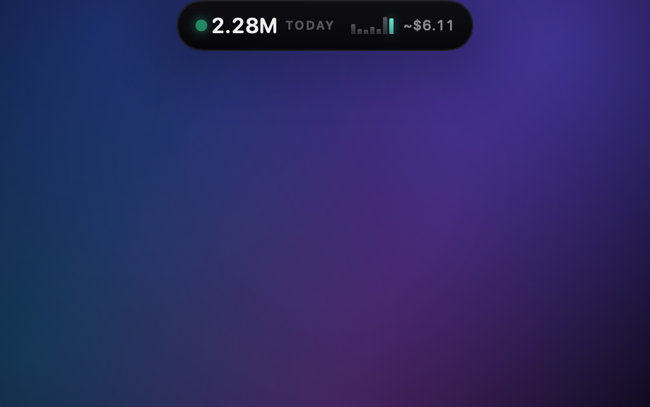
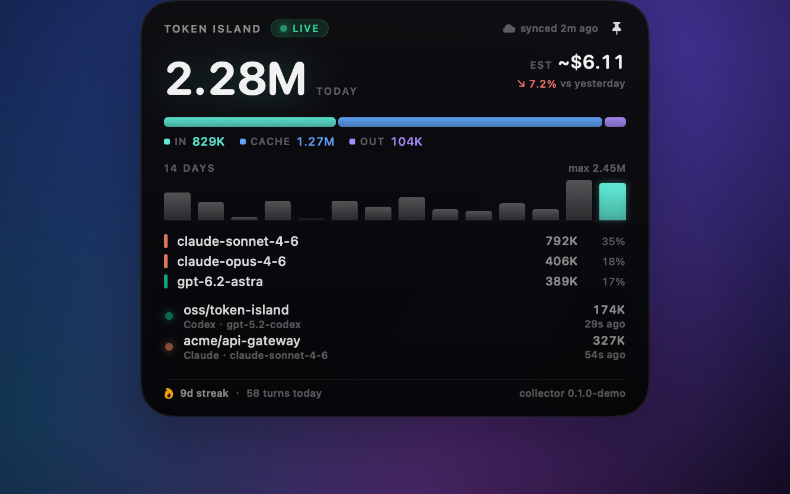
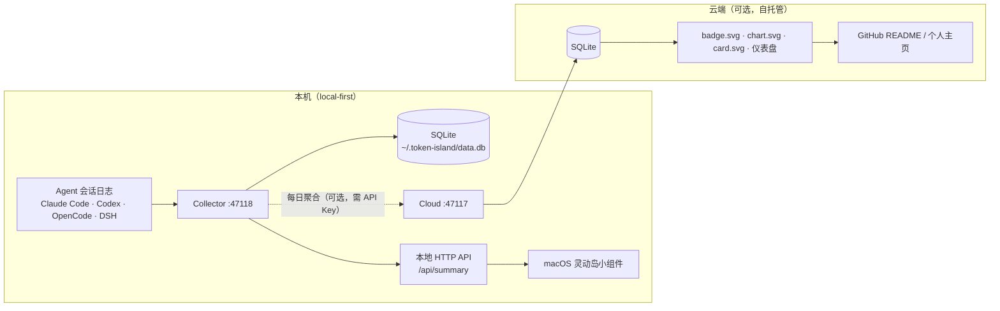
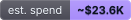

# Token Island

> 本地优先的 AI Coding Agent Token 消耗追踪器：macOS 灵动岛实时显示今天花了多少 token，云端一键生成 GitHub README 徽章、图表和名片。


<!-- TODO(qa): Phase 2 运行 `bash scripts/snapshot-island.sh` 生成 docs/images/ 下的真实截图，并在此处补 1 张 dashboard 截图（docs/images/dashboard.png）。 -->

<p align="center">
  
  
</p>

---

## 为什么做这个

同时在用 Claude Code、OpenAI Codex、OpenCode、DeepSeek Harness 的时候，**token 消耗分散在各自的会话日志里，无从感知**：

- 每个 agent 各写各的日志，没有一个地方能回答「我今天到底用了多少 token」；
- 供应商后台只按账号/账单汇总，看不到是哪个项目、哪个模型、哪个时段在烧钱；
- 等月底看到账单时，已经来不及调整用法；
- 想把用量放进 GitHub 主页或 README，没有现成、好看、可自动更新的组件。

Token Island 把这件事拆成三层，全部可以只在本地运行：

1. **Collector**：增量解析本机 agent 会话日志，归一化后写入 SQLite，暴露本地 HTTP API；
2. **Dynamic Island（灵动岛）**：macOS 原生 SwiftUI 小组件，悬浮在刘海/屏幕顶部，2 秒轮询刷新；
3. **Cloud**：零依赖 Node 服务，接收**每日聚合**数据，渲染 GitHub README 友好的 SVG 徽章、图表、名片和仪表盘。

## 核心特性

- **多 agent 统一口径**：Claude Code / OpenAI Codex / OpenCode / DeepSeek Harness，统一为 `UsageEvent`（输入、输出、缓存读、缓存写、推理 token 与估算成本）。
- **本地优先**：原始日志从不离开本机；collector 只监听 `127.0.0.1`。
- **实时灵动岛**：收起态显示今日 token，展开态展示成本、输入/缓存/输出占比、14 天曲线、Top 模型、活跃会话和 streak。
- **增量 & 幂等**：按文件 offset 增量读取，事件 id 去重，重启/重复扫描不会重复计数；大文件流式读取。
- **GitHub README 组件**：`badge.svg`（7 种指标）、`chart.svg`（line/bar/heatmap/models）、`card.svg`、带可复制嵌入代码的 dashboard。
- **零运行时依赖**：除 Node.js 与 macOS 原生 SwiftUI 外，不引入第三方运行时包。
- **可离线**：`tokenisland collect --demo` 提供确定性演示数据；灵动岛 `--demo` 可用内置 fixture 独立展示。

## 架构



<details>
<summary>ASCII 架构图（mermaid 无法渲染时）</summary>

```text
┌────────────────────────────── 本机（local-first） ──────────────────────────────┐
│  Claude Code / Codex / OpenCode / DSH 会话日志                                    │
│          │                                                                        │
│          ▼                                                                        │
│  Collector(:47118) ──▶ SQLite(~/.token-island/data.db)                            │
│          │                                                                        │
│          ├──▶ GET /api/summary ──▶ macOS 灵动岛小组件（2s 轮询）                    │
│          │                                                                        │
│          └── 每日聚合（可选，云端未启用时不出机器）──┐                              │
└──────────────────────────────────────────────────────┼────────────────────────────┘
                                                       ▼
┌────────────────────────────── 云端（可选，自托管） ──────────────────────────────┐
│  Cloud(:47117) ──▶ SQLite ──▶ badge.svg / chart.svg / card.svg / dashboard       │
│                                    │                                              │
│                                    └──▶ GitHub README / 个人主页                  │
└───────────────────────────────────────────────────────────────────────────────────┘
```

</details>

数据流的三条不变量：

1. 原始日志、`cwd`、`project`、会话 id、prompt 内容**只留在本机**；
2. 云端只接收 `CloudDay`（日期 + token 计数 + 成本估算 + 消息数 + 模型 id），不接收任何路径或正文；
3. 云端不可用时 collector 继续工作，同步失败只记录错误、下个周期重试。

## 快速开始

环境要求：**Node.js >= 22.5**（推荐 22 LTS）、**pnpm 10**；灵动岛需要 **macOS 13+**。

```bash
# 1. 安装依赖
git clone <repo-url> token-island
cd token-island
pnpm install

# 2. 体检：node 版本、依赖、collector/cloud 是否在跑、灵动岛是否已构建、数据源是否存在
node bin/tokenisland.mjs doctor

# 3. 启动 collector（前台运行，首次会回填最近 30 天，可用 --backfill-days 调整）
node bin/tokenisland.mjs collect --foreground

# 4. 另开一个终端，确认 API 正常
node bin/tokenisland.mjs status
curl -s 'http://127.0.0.1:47118/api/summary?range=today' | head -c 400
```

> 不想改 `~` 下的数据？开发/测试时用 `TOKEN_ISLAND_HOME=<repo>/.runtime/collector` 指向工作区内的目录。

<!-- TODO(qa): Phase 2 逐条执行本节的命令，补充真实输出片段（首次扫描耗时、识别到的数据源/事件数），并修正与实现不一致之处。 -->

### 安装灵动岛

```bash
pnpm island:build                 # swift build + 组装 build/TokenIsland.app
node bin/tokenisland.mjs island   # 先直接运行看看（已安装 LaunchAgent 时会重启它）
node bin/tokenisland.mjs install  # 可选：安装到 ~/Applications 并开机自启（无需 sudo）
```

灵动岛会轮询 `http://127.0.0.1:47118/api/summary?range=today&days=14`。默认收起为顶部胶囊，悬停/点击展开；连不上 collector 超过 3 次后显示 `OFFLINE`，恢复后自动重连。

### 启动云端（本地）

```bash
# 终端 2：启动云端（默认 :47117，数据默认 ./data/cloud.db）
node bin/tokenisland.mjs cloud start

# 终端 3：写入演示账号 demo / alice（幂等，会打印示例 URL 与 API Key）
node bin/tokenisland.mjs cloud seed

# 注册自己的用户名并把 API Key 写入 ~/.token-island/config.json
node bin/tokenisland.mjs register --cloud http://127.0.0.1:47117 --username <你的用户名>

# 重启 collector 后会自动同步；也可以手动推一次
node bin/tokenisland.mjs sync

open http://127.0.0.1:47117/u/<你的用户名>   # dashboard
```

完整链路可以一条命令验证：

```bash
pnpm e2e                                # typecheck + test + collector + cloud + island 快照
node --import tsx scripts/e2e.ts --skip-core-tests   # 跳过 core 测试，只跑集成断言
pnpm dev                                # 一条命令同时起 collector + cloud（状态在 .runtime/dev）
```

## GitHub README 徽章 / 图表

云端把数据渲染成纯手写 SVG：没有外部字体、脚本和图片，GitHub README 可直接引用。

### 方式 A：公网部署，使用实时 SVG URL

把云端部署到任意公网地址（见下方「云端部署」），然后在 README 中引用：

```html
/badge.svg?metric=tokens&theme=dark" alt="tokens" />
/chart.svg?type=line&days=30&theme=dark" alt="token chart" />
/card.svg?theme=dark" alt="profile card" />
```

数据每次 sync 后都会自动更新。**注意：`http://127.0.0.1:47117` 这类本地地址无法被 github.com 访问**，只能在自己浏览器里预览。

### 方式 B：导出静态 SVG 并提交（无需公网部署）

```bash
# 下载 7 种徽章 + 4 种图表 + 名片到 docs/badges/，并打印可直接粘贴的 Markdown
node bin/tokenisland.mjs export --cloud http://127.0.0.1:47117 --user <user> --out docs/badges --days 30
```

把 `docs/badges/` 提交进仓库后，README 里用仓库相对路径即可（示例）：

```markdown




```

静态导出不会自动更新，重新 `sync` 后再执行一次 `export` 即可刷新。

### 徽章指标与查询参数

| 指标 `metric=` | 含义 | 默认窗口 |
| --- | --- | --- |
| `tokens` | 区间总 token 数（左标签 `tokens`） | 30 天 |
| `cost` | 估算花费（`~$72.99`） | 30 天 |
| `streak` | 连续活跃天数（`9d`） | 当前 streak |
| `messages` | agent 回合数（`12.4K`） | 30 天 |
| `day` | 今日 token | 今天 |
| `model` | 消耗最高的模型（截断 22 字符） | 30 天 |
| `status` | `live` / `idle`（24 小时内是否同步过） | 最近同步 |

通用参数：`theme=dark|light|auto`（默认 dark）、`label=<自定义左标签>`、`days=1..365`、`style=flat|flat-square`。

### 示例（本地 seed 后可用）

`node bin/tokenisland.mjs cloud seed` 会创建 `demo` 用户，下面是可直接在本地浏览器/README 中使用的示例表格：

| 组件 | URL |
| --- | --- |
| Tokens 徽章 | `http://127.0.0.1:47117/u/demo/badge.svg?metric=tokens&theme=dark` |
| 花费徽章 | `http://127.0.0.1:47117/u/demo/badge.svg?metric=cost&theme=dark` |
| Streak 徽章 | `http://127.0.0.1:47117/u/demo/badge.svg?metric=streak&theme=dark` |
| 折线图 | `http://127.0.0.1:47117/u/demo/chart.svg?type=line&days=30&theme=dark` |
| 柱状图 | `http://127.0.0.1:47117/u/demo/chart.svg?type=bar&days=30&theme=dark` |
| 热力图 | `http://127.0.0.1:47117/u/demo/chart.svg?type=heatmap&days=182&theme=dark` |
| 模型分布 | `http://127.0.0.1:47117/u/demo/chart.svg?type=models&days=30&theme=dark` |
| 名片 | `http://127.0.0.1:47117/u/demo/card.svg?theme=dark` |
| 仪表盘 | `http://127.0.0.1:47117/u/demo` |

<!-- TODO(qa): Phase 2 用 seed 数据核对上述 URL 与徽章数值，补充真实渲染截图（docs/images/badge-example.png、docs/images/dashboard.png）。 -->

## 云端部署

云端是零依赖 Node 服务，可部署到任意容器平台；`apps/cloud/` 内置 `Dockerfile`（构建上下文为仓库根目录）、`railway.json` 和 `DEPLOY.md`。

```bash
# Docker（构建上下文必须是仓库根目录，Dockerfile 会复制 packages/core）
docker build -f apps/cloud/Dockerfile -t token-island-cloud .
docker run -d --name token-island -p 47117:8080 \
  -v token-island-data:/data \
  -e TOKEN_ISLAND_ALLOW_REGISTER=1 \
  token-island-cloud
```

| 环境变量 | 默认值 | 说明 |
| --- | --- | --- |
| `PORT` | `47117`（容器内 `8080`） | 服务监听端口 |
| `TOKEN_ISLAND_CLOUD_DB` | `./data/cloud.db` | SQLite 路径；容器内为 `/data/cloud.db`，需挂载 volume |
| `TOKEN_ISLAND_ADMIN_TOKEN` | 空 | 设置后 `POST /api/v1/register` 需要 `Authorization: Bearer <admin token>` |
| `TOKEN_ISLAND_ALLOW_REGISTER` | `1` | `0` 关闭公开注册 |

Railway：仓库根目录的 `railway.json` 已指向该 Dockerfile，添加 volume 挂到 `/data` 即持久化。部署后把 `https://<your-domain>` 填到 collector 的 `config.cloud.url`，即可使用实时徽章（方式 A）。

<!-- TODO(qa): Phase 2 实际跑通 Docker/Railway 步骤，核对 apps/cloud/DEPLOY.md 链接与命令，补充部署后的真实示例 URL。 -->

## CLI 参考

所有命令都可以通过 `node bin/tokenisland.mjs <command>` 运行（想更顺手可以 `alias ti="node $PWD/bin/tokenisland.mjs"`）。完整帮助：`node bin/tokenisland.mjs help <command>`。

| 命令 | 说明 |
| --- | --- |
| `collect [--foreground] [--once] [--demo] [--reset] [--backfill-days N]` | 运行 collector：解析日志、写 SQLite、服务本地 API；`--demo` 使用演示数据并监听 `:47119` |
| `sync` | 把当前每日聚合手动推送到云端一次 |
| `status [--port N] [--demo]` | 查询 collector 的 `/api/health` 并打印 JSON；离线时打印 `offline` |
| `register --cloud <url> --username <name>` | 向云端注册并原子写入 API Key（配置文件权限 600） |
| `export [--cloud <url>] [--user <name>] [--out docs/badges] [--days 30] [--theme dark]` | 导出静态 SVG，供 GitHub README 使用 |
| `cloud start [--port N] [--db <path>]` / `cloud seed [--db <path>]` | 启动云端 / 写入幂等演示数据并打印示例 URL |
| `island [--snapshot <out.png> --state <mode>] [--demo]` | 启动灵动岛；`--snapshot`/`--snapshot-all` 渲染 PNG 后退出（`--state` 取 `collapsed` / `expanded` / `offline`） |
| `install` / `uninstall` | 安装/卸载灵动岛到 `~/Applications` + LaunchAgent（无需 sudo） |
| `doctor` | 体检：node、依赖、collector/cloud 连通性、灵动岛构建、数据源 |
| `help [command]` | 全局或单命令帮助 |

示例：

```bash
node bin/tokenisland.mjs collect --demo                          # 演示数据，:47119
node bin/tokenisland.mjs status --demo                           # 查询演示 collector
node bin/tokenisland.mjs island --snapshot docs/images/island-expanded.png \
  --state expanded --scale 2 --background wallpaper               # 渲染 README 截图
```

## 配置说明

配置位于 `~/.token-island/config.json`（可用 `TOKEN_ISLAND_HOME` 覆盖目录）。所有键都可省略，collector / 灵动岛 / CLI 共享同一份文件：

```jsonc
{
  "port": 47118,
  "timezone": "auto",                 // "auto" = 系统时区，或 IANA id（如 "Asia/Singapore"）
  "backfillDays": 30,                 // 只扫描最近 N 天修改过的会话文件
  "scanIntervalMs": 2000,
  "liveWindowMs": 600000,             // 10 分钟内有事件的会话视为活跃
  "sources": { "claude": true, "codex": true, "opencode": true, "dsh": true, "gemini": false },
  "paths": {                          // 可选：覆盖数据源目录，~ 会展开
    "claude": "~/.claude",
    "codex": "~/.codex",
    "opencode": "~/.local/share/opencode",
    "dsh": "~/.dsh"
  },
  "prices": [                         // 覆盖/扩展内置价目表，单位：USD / 1M tokens
    { "match": "my-internal-model", "input": 0.5, "output": 1.5 }
  ],
  "cloud": {
    "enabled": false,
    "url": "http://127.0.0.1:47117",
    "username": "demo",
    "apiKey": "ti_...",
    "autoSync": true,
    "intervalMinutes": 15
  }
}
```

> 示例中的注释只用于说明；实际 `config.json` 必须是合法 JSON（不能带注释）。`register` 会保留已有键，只合并 `cloud.*`，并以原子写入 + `chmod 600` 保护 API Key。

相关环境变量：

| 变量 | 作用 |
| --- | --- |
| `TOKEN_ISLAND_HOME` | 状态目录（默认 `~/.token-island`）：`config.json`、`data.db` |
| `TOKEN_ISLAND_PORT` | collector 端口覆盖（默认 47118；`--demo` 为 47119） |
| `TOKEN_ISLAND_CLOUD_DB` | 云端 SQLite 路径 |
| `PORT` | 云端 HTTP 端口（默认 47117） |
| `TOKEN_ISLAND_ADMIN_TOKEN` | 设置后注册接口需要管理员令牌 |
| `TOKEN_ISLAND_ALLOW_REGISTER` | `0` 关闭云端公开注册 |

## 数据源与隐私

| Agent | 默认路径 | 解析要点 |
| --- | --- | --- |
| Claude Code | `~/.claude/projects/**/*.jsonl` | `message.usage`，按 `message.id` 去重（同一条消息会出现约 2 次） |
| OpenAI Codex | `~/.codex/sessions/**/rollout-*.jsonl` | `token_count.last_token_usage` 的每轮增量；缓存 token 从 input 中扣除 |
| OpenCode | `~/.local/share/opencode/opencode.db` | 只读打开，按 message id 去重，优先采用 OpenCode 已算好的 cost |
| DeepSeek Harness | `~/.dsh/sessions/*/*/session.v4.jsonl.zstd` | 多帧 zstd（调用 `zstd -dc`），小文件按 `(size, mtime)` 变化时重解析 |

- **只读本地文件**：collector 只读取上述日志，写入自己的 `~/.token-island/data.db`。
- **云端只收到每日聚合**：`CloudDay = { date, 各类 token 数, costUsd, messages, models }`，不包含 prompt 内容、绝对路径、项目名、会话 id。
- **本地 API 只监听 `127.0.0.1`**，不对外网开放；CORS 放开仅用于本机页面/小组件读取。
- **默认不上传**：`cloud.enabled=false` 时数据不会离开本机；执行 `register` 后才启用同步。
- **API Key 只返回一次**：云端只保存 key 的 sha256；本地明文仅存在于权限 600 的 `config.json`。
- 想关闭某个数据源：在 `config.json` 的 `sources` 里设为 `false`；目录不存在时采集器会自动跳过、不报错。

## 定价免责声明

- 展示的成本是**按公开价目表估算**的美元金额（单位：USD / 1M tokens），用于横向比较和自我感知，**不是账单**，也不构成任何费用承诺。
- 缓存读写、推理 token、批处理折扣、订阅套餐、区域价格等各家计费规则不同且会变化，估算与实际账单可能存在偏差。
- 无法匹配价目表的模型会计入 `unpricedTokens` 且**不计入成本**（界面会提示）。
- 可以用 `config.json` 的 `prices` 覆盖或补充价格；发现内置价目过时可以提 issue/PR。

## FAQ

**Q：`doctor` 显示 collector / cloud 是 ✗？**
正常——它们是服务，不是常驻进程。`node bin/tokenisland.mjs collect --foreground` 和 `node bin/tokenisland.mjs cloud start` 启动后重新体检即可；`island` 显示 ✗ 则需要先 `pnpm island:build`。

**Q：采集到的 token 数是 0 / 比预期少？**
确认对应 agent 的日志目录存在、最近 `backfillDays` 天内使用过；用 `doctor` 查看「Agent data sources」；需要更早数据时用 `collect --reset --backfill-days 90` 重建。首次启动只回填最近 30 天是刻意的（避免一开始就扫几百 MB 历史文件）。

**Q：端口被占用怎么办？**
collector 用 `TOKEN_ISLAND_PORT=47120` 换端口（灵动岛同环境变量会跟随）；云端用 `PORT=47118` 或 `cloud start --port N`。e2e 固定使用 47119/47117，跑之前先停掉手工启动的服务。

**Q：只想追踪一个 agent 可以吗？**
可以。把其他 `sources` 设为 `false` 即可，不存在的日志目录会自动跳过。

**Q：数据会上传到云端吗？**
默认不会。只有执行 `register`（写入 API Key）后，collector 才会按 `intervalMinutes` 把**每日聚合**同步到云端；关掉 `cloud.enabled` 立即停止。

**Q：如何彻底删除本地数据？**
停止 collector 后删除 `~/.token-island/`（含 `data.db` 与 `config.json`）；卸载灵动岛用 `node bin/tokenisland.mjs uninstall`。

**Q：灵动岛不显示 / 没有 Dock 图标？**
这是菜单栏应用（`LSUIElement`），没有 Dock 图标是正常的；检查菜单栏的闪电图标，或 `node bin/tokenisland.mjs island` 重新拉起。需要 macOS 13+。

**Q：GitHub README 里的图片不显示？**
github.com 无法访问 `127.0.0.1`。要么把云端部署到公网改用实时 URL（方式 A），要么用 `node bin/tokenisland.mjs export` 导出静态 SVG 并提交（方式 B）。

**Q：演示模式会污染真实数据吗？**
不会。`collect --demo` 不写 SQLite，只使用内存中的确定性演示数据并监听 `:47119`；`island --demo` 使用内置 `fixtures/summary.example.json`。

**Q：e2e 太慢，只想跑集成部分？**
`node --import tsx scripts/e2e.ts --skip-core-tests`。

## 目录结构

```text
token-island/
├── bin/tokenisland.mjs          # 零依赖 CLI 入口
├── packages/core/               # 共享类型、定价、聚合、格式化（纯函数 + 测试）
├── apps/collector/              # 采集守护进程：日志解析 → SQLite → 本地 API → 云同步
├── apps/cloud/                  # 云端：注册/ingest + SVG 徽章/图表/名片/仪表盘
├── apps/island-macos/           # SwiftUI 灵动岛小组件（含快照渲染模式）
├── fixtures/                    # 确定性演示数据（summary/events/cloud-days）
├── scripts/                     # dev / e2e / snapshot / gen-fixtures
├── docs/CONTRACT.md             # 各模块接口与验收契约
├── docs/ARCHITECTURE.md         # 架构、失败处理与扩展指南
├── docs/images/                 # README 截图与示例图
└── README.md
```

## Roadmap

- [x] Collector：多数据源增量解析 + SQLite + 本地 HTTP API + 云同步
- [x] 灵动岛：收起/展开/离线三态、菜单栏、快照渲染
- [x] 云端：注册/ingest、7 种徽章、4 种图表、名片、dashboard
- [x] `tokenisland` CLI + `doctor` + `export`
- [ ] 更多数据源（Gemini CLI、Cursor 等）
- [ ] 预算/限额提醒（今日超支高亮、通知）
- [ ] 多机 / 团队聚合视图
- [ ] Windows / Linux 桌面小组件
- [ ] 一键部署模板（Railway / Fly.io / Docker Compose）
- [ ] 更完整的实时同步（SSE 增量推送）

## License

MIT

<!-- TODO(qa): Phase 2 确认仓库根目录的 LICENSE（MIT）文件由 Lead 补齐；若存在则把上面一行改成 [MIT](LICENSE)。 -->
